# Displacement forecast

This is a WIP. All this is going to change, for now we're just dumping things here.

## Forecast for 2025-10-21 12:00 UTC

There are 3 active named storms.

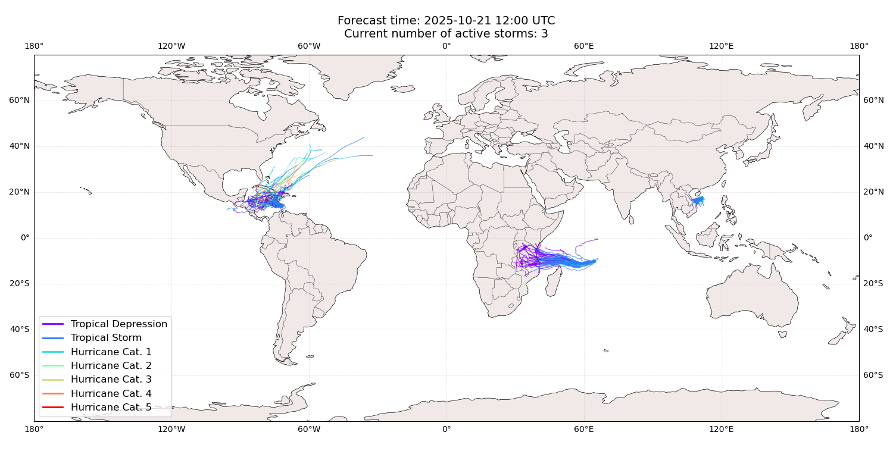

## FENGSHEN China: areas affected

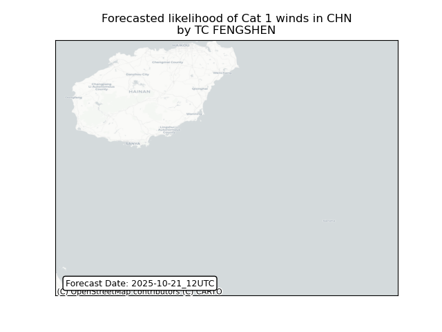

## FENGSHEN China: people exposed

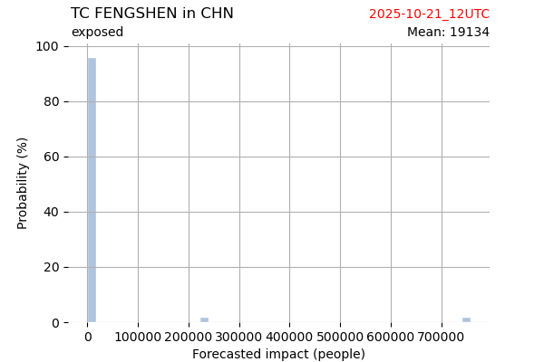

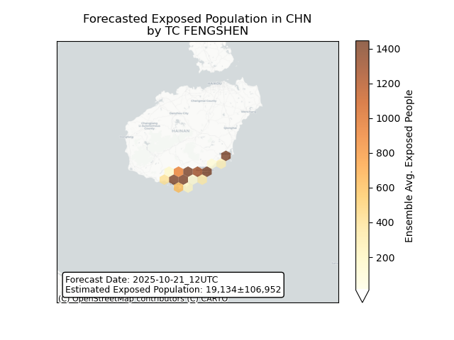

## FENGSHEN China: people displaced

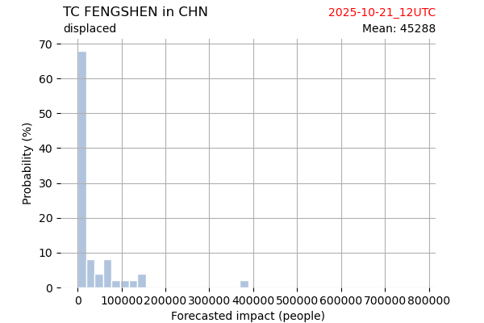

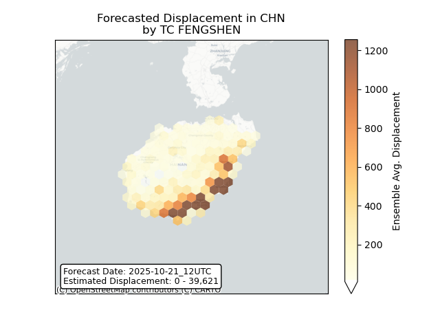

## CHENGE Madagascar: areas affected

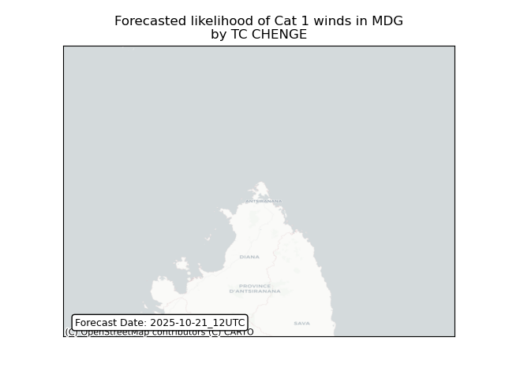

## CHENGE Madagascar: people exposed

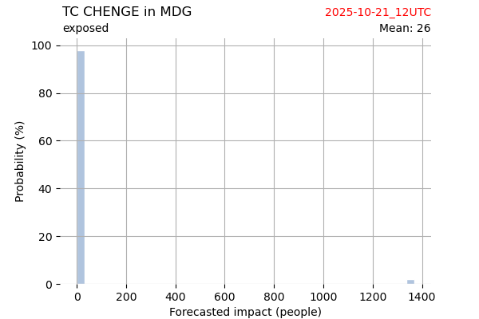

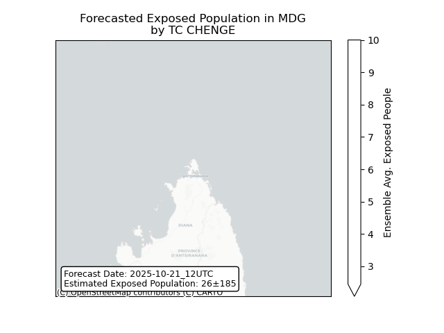

## CHENGE Madagascar: people displaced

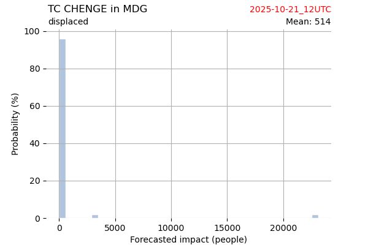

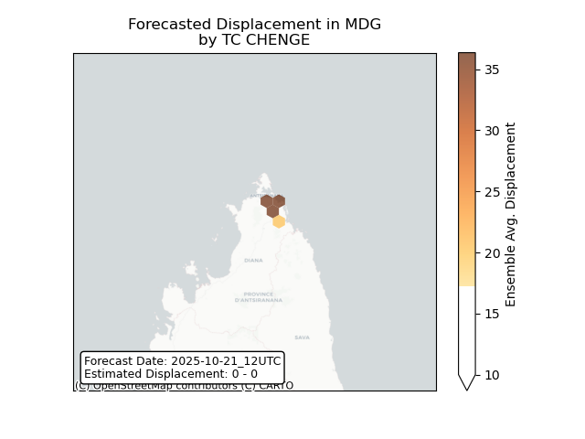

## CHENGE Mozambique: areas affected

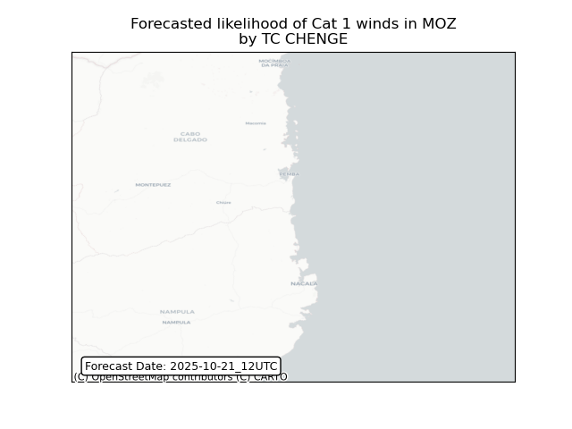

## MELISSA Bahamas: no forecast people displaced

Storm MELISSA is not forecast to displace people in Bahamas.

## MELISSA Bahamas: areas affected

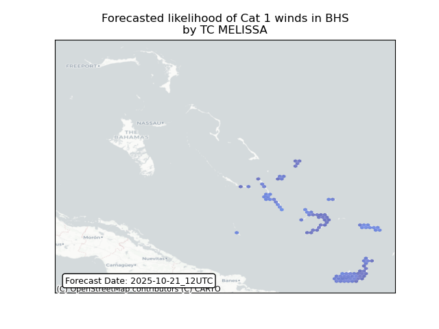

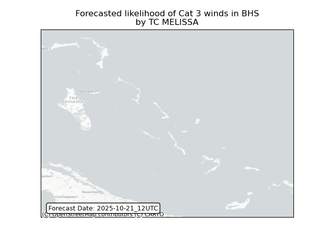

## MELISSA Bahamas: people exposed

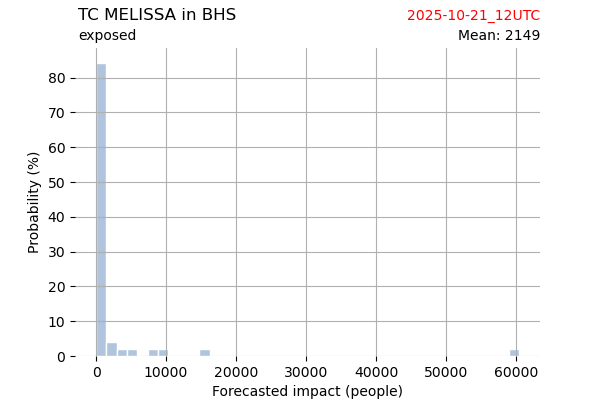

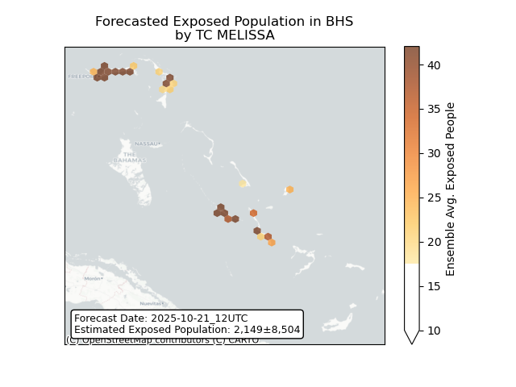

## MELISSA Bahamas: people displaced

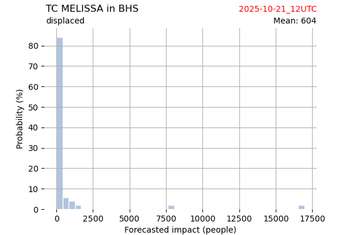

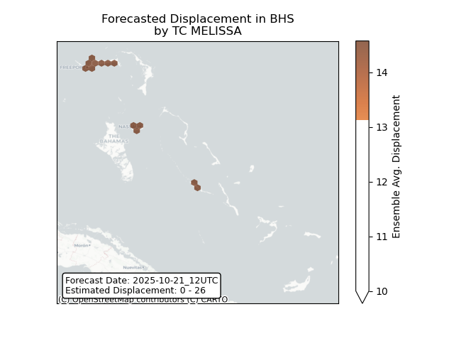

## MELISSA Bermuda: areas affected

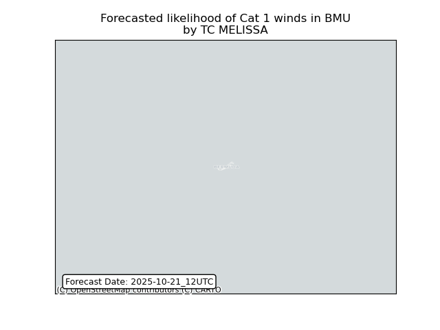

## MELISSA Bermuda: people exposed

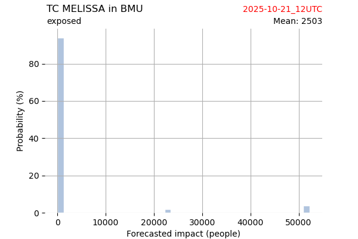

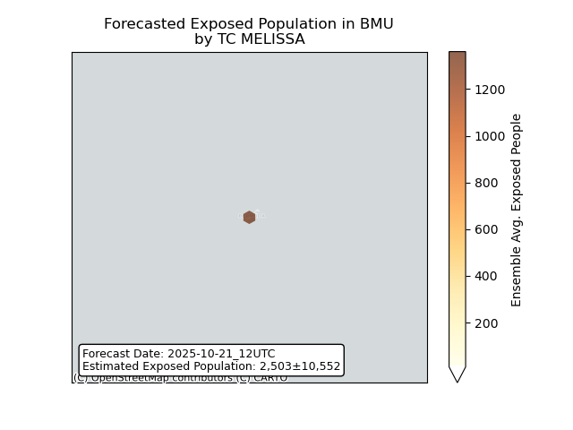

## MELISSA Bermuda: people displaced

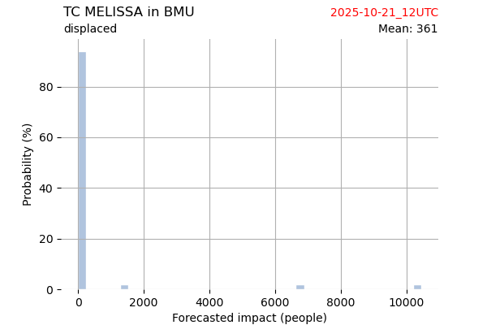

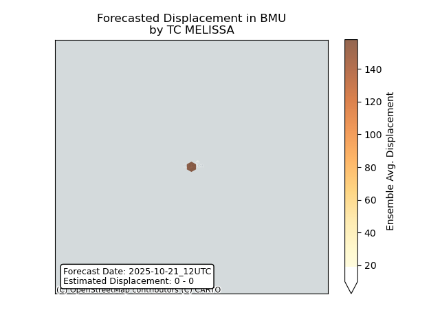

## MELISSA Cayman Islands: areas affected

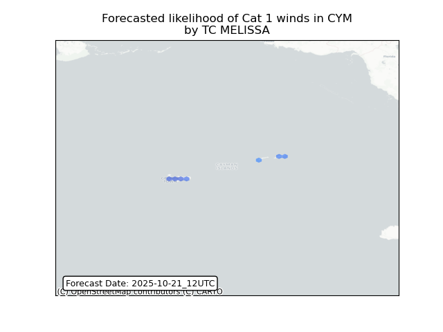

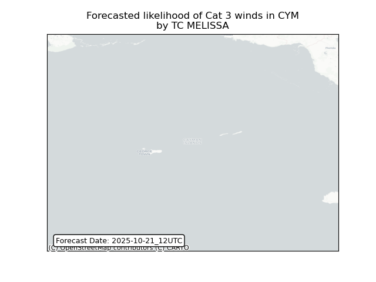

## MELISSA Cayman Islands: people exposed

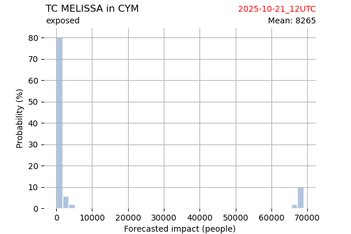

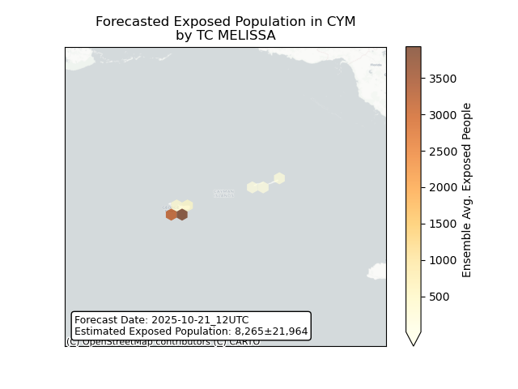

## MELISSA Cayman Islands: people displaced

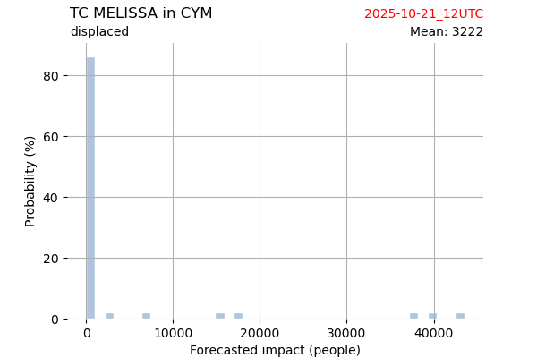

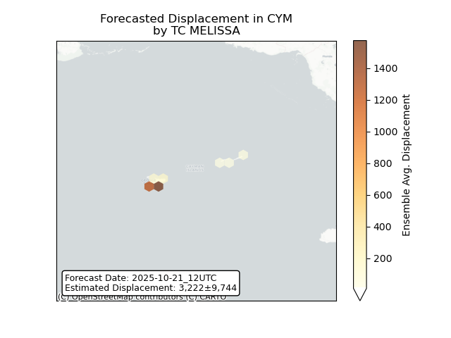

