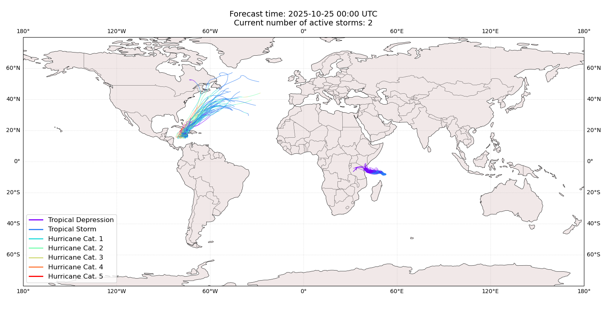
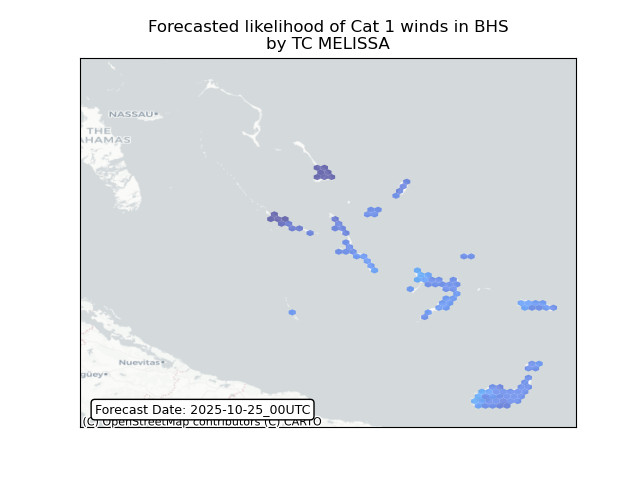
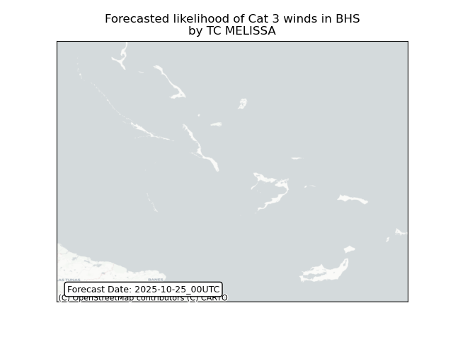
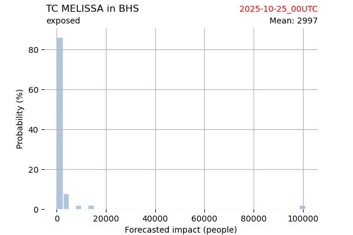
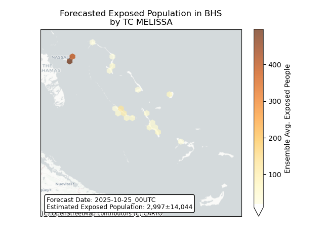
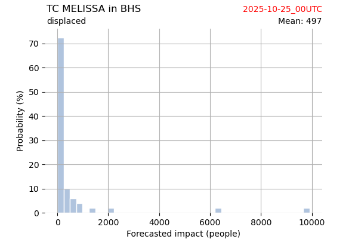
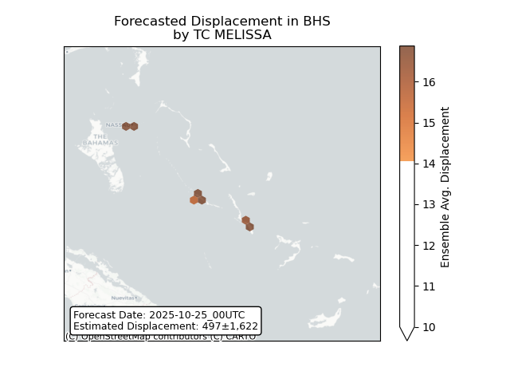

# Displacement forecast

This is a WIP. All this is going to change, for now we're just dumping things here.

## Forecast for 2025-10-25 00:00 UTC

There are 2 active named storms.

## CHENGE All countries: No forecast people exposed

Storm CHENGE is not forecast to affect people in All countries.

## CHENGE All countries: no forecast people displaced

Storm CHENGE is not forecast to displace people in All countries.

## MELISSA Bahamas: areas affected

## MELISSA Bahamas: people exposed

## MELISSA Bahamas: people displaced

