# Displacement forecast

This is a WIP. All this is going to change, for now we're just dumping things here.

## Forecast for 2026-10-01 12:00 UTC

There are 4 active named storms.

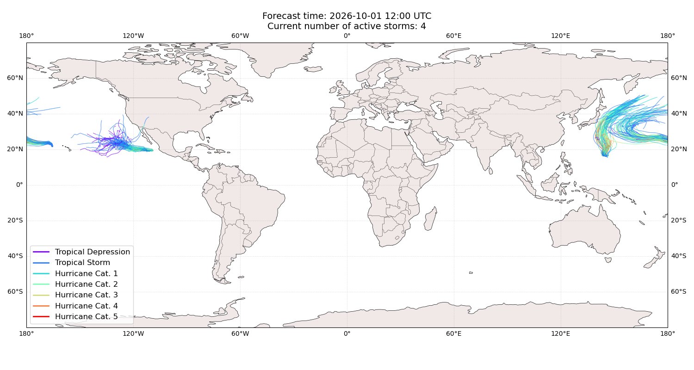

## CHOI-WAN Japan: areas affected

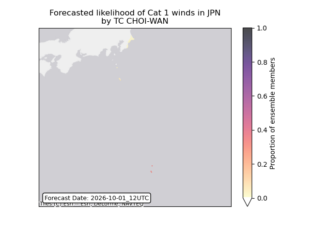

## CHOI-WAN Japan: people exposed

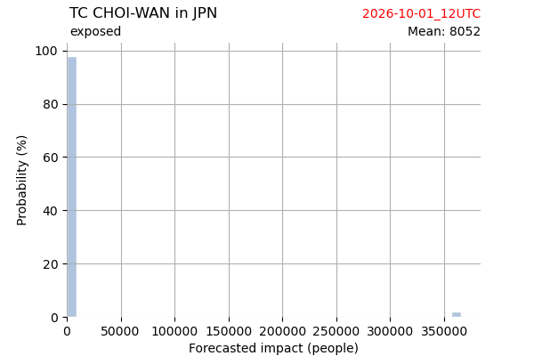

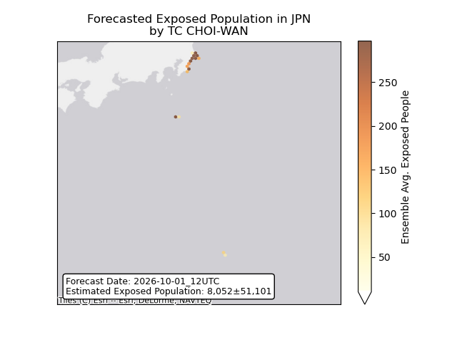

## CHOI-WAN Japan: people displaced

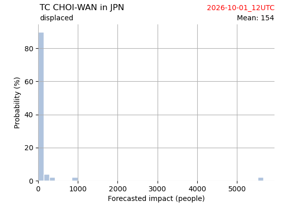

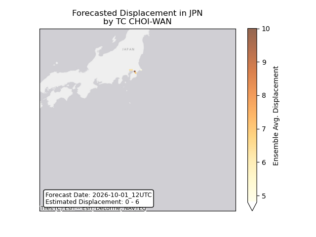

## CHOI-WAN Northern Mariana Islands: areas affected

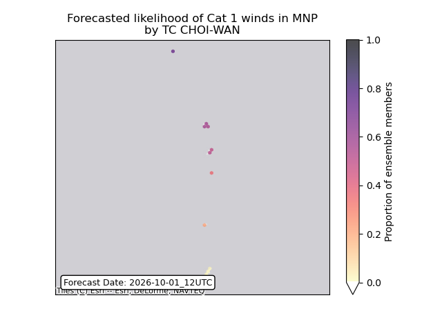

## CHOI-WAN Northern Mariana Islands: people exposed

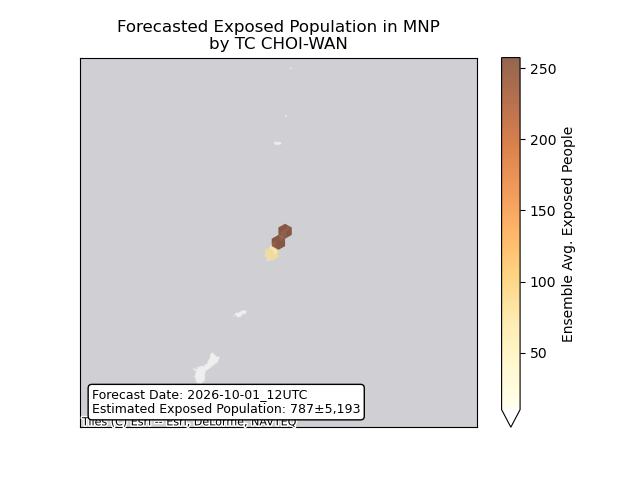

## CHOI-WAN Northern Mariana Islands: people displaced

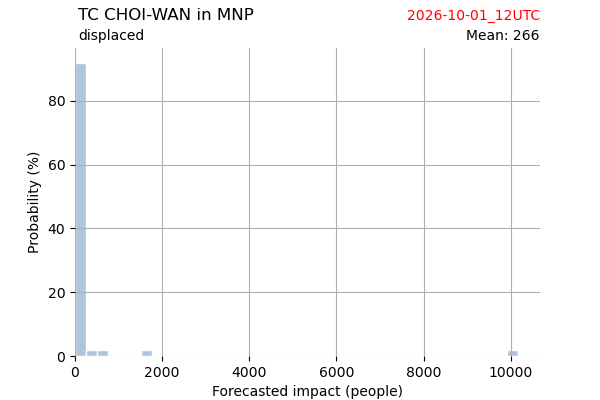

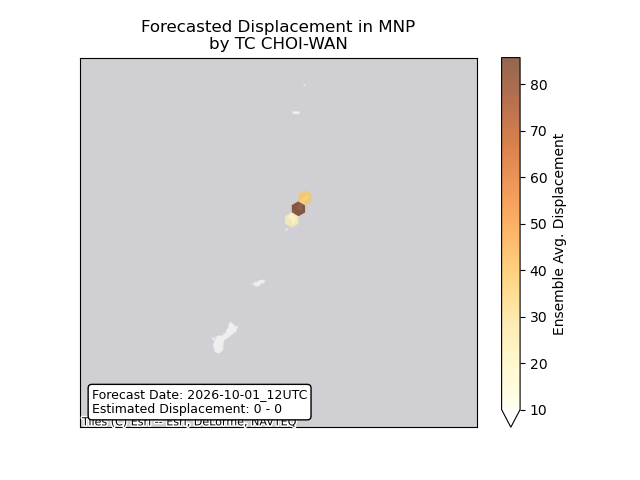

## SURIGAE All countries: No forecast people exposed

Storm SURIGAE is not forecast to affect people in All countries.

## SURIGAE All countries: no forecast people displaced

Storm SURIGAE is not forecast to displace people in All countries.

## NOLO All countries: No forecast people exposed

Storm NOLO is not forecast to affect people in All countries.

## NOLO All countries: no forecast people displaced

Storm NOLO is not forecast to displace people in All countries.

## RACHEL Mexico: areas affected

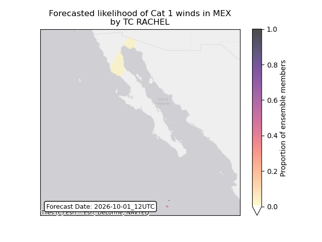

## RACHEL Mexico: people exposed

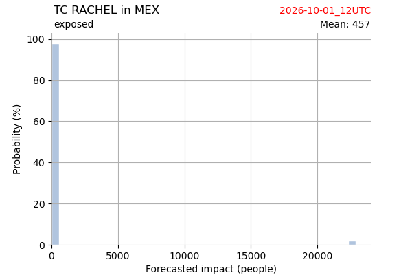

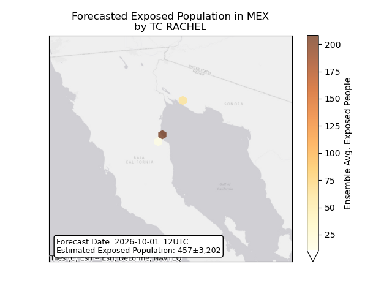

## RACHEL Mexico: people displaced

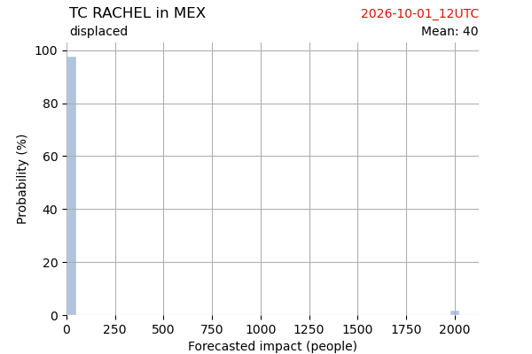

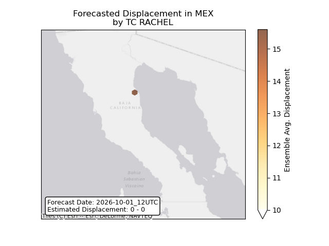

## RACHEL United States: areas affected

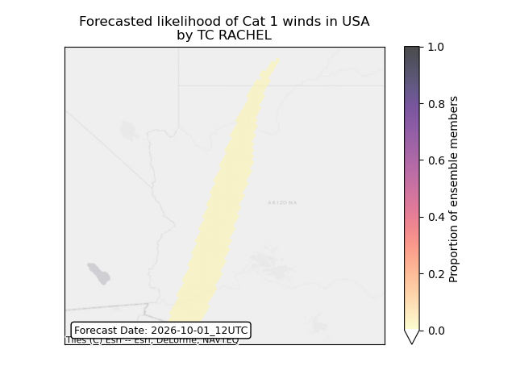

## RACHEL United States: people exposed

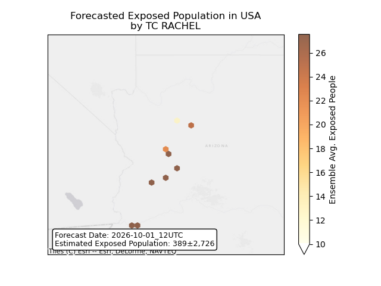

## RACHEL United States: people displaced

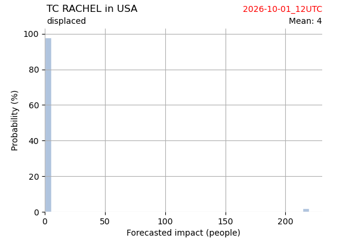

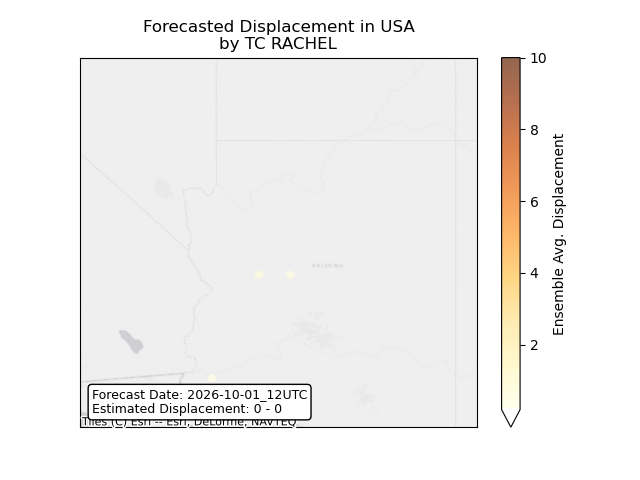

