# Displacement forecast

This is a WIP. All this is going to change, for now we're just dumping things here.

## Forecast for 2026-10-14 00:00 UTC

There are 3 active named storms.

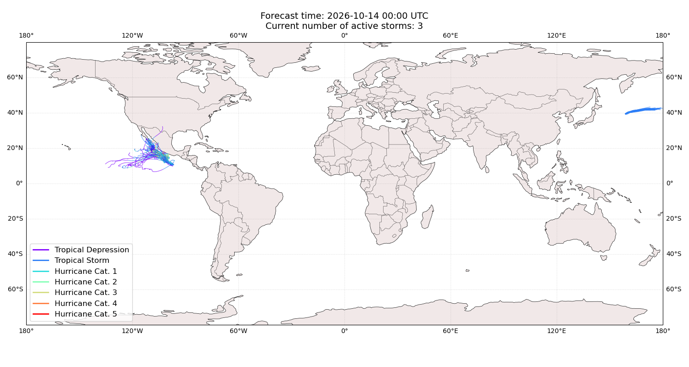

## KOGUMA All countries: No forecast people exposed

Storm KOGUMA is not forecast to affect people in All countries.

## KOGUMA All countries: no forecast people displaced

Storm KOGUMA is not forecast to displace people in All countries.

## TRUDY Mexico: areas affected

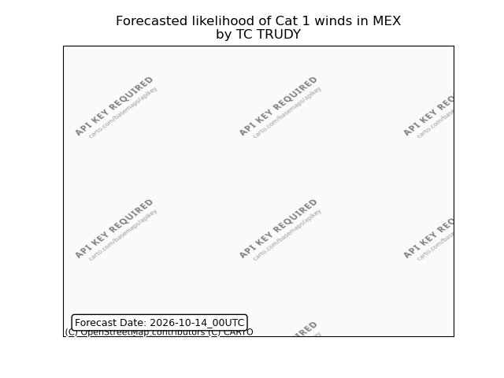

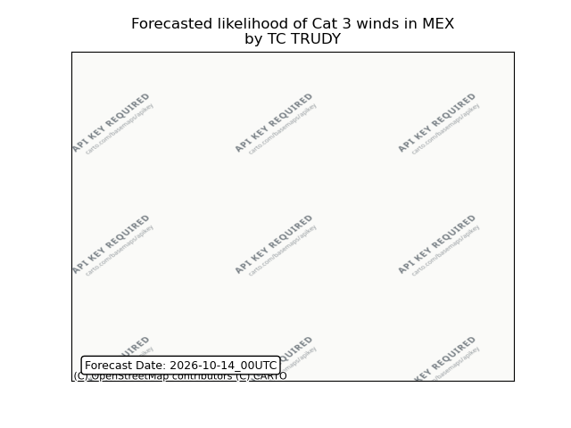

## TRUDY Mexico: people exposed

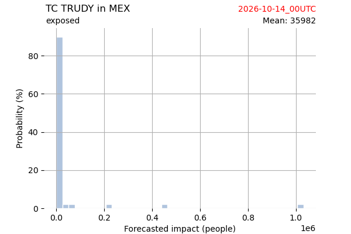

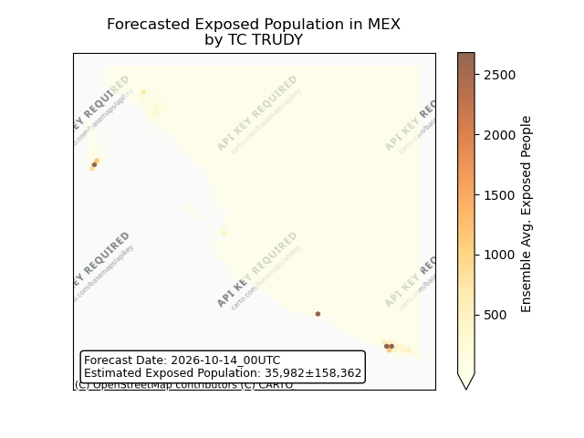

## TRUDY Mexico: people displaced

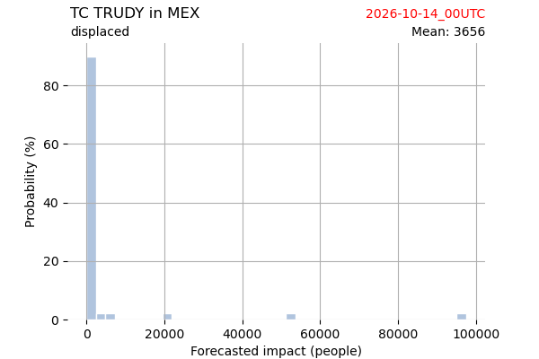

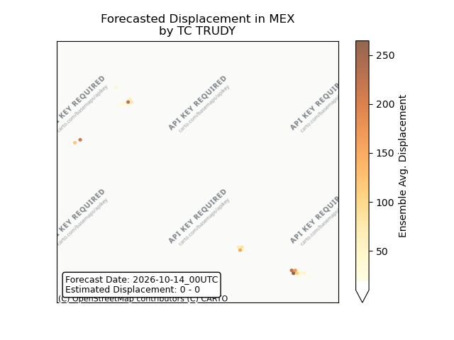

## SIMON Mexico: areas affected

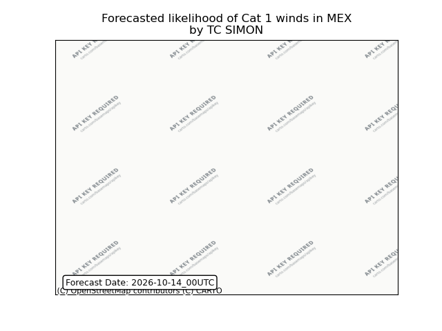

## SIMON Mexico: people exposed

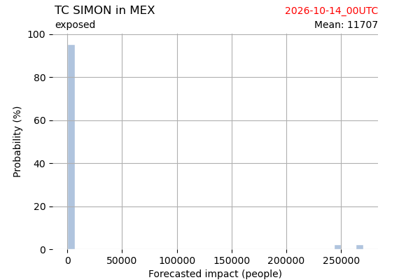

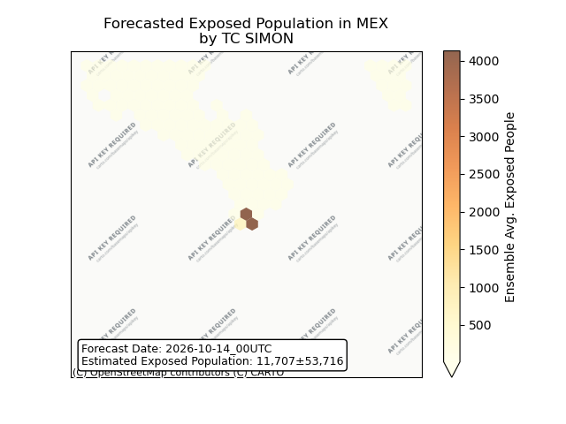

## SIMON Mexico: people displaced

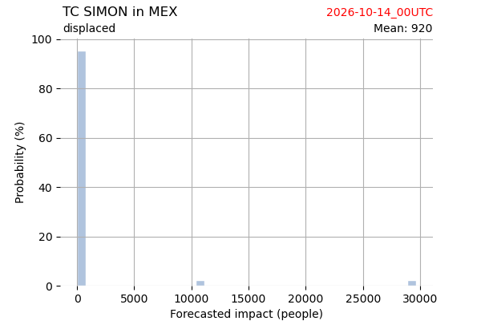

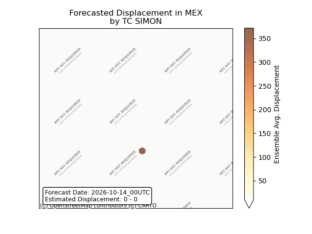

