# Displacement forecast

This is a WIP. All this is going to change, for now we're just dumping things here.

## Forecast for 2026-10-23 12:00 UTC

There are 3 active named storms.

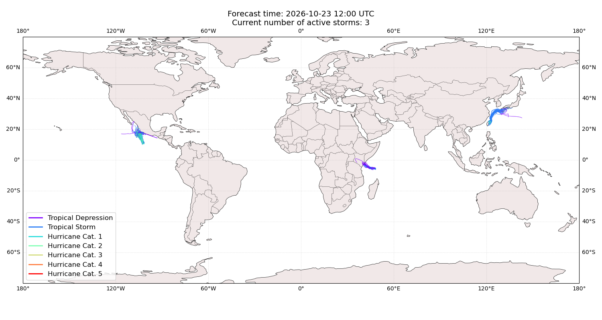

## AGUEDA All countries: No forecast people exposed

Storm AGUEDA is not forecast to affect people in All countries.

## AGUEDA All countries: no forecast people displaced

Storm AGUEDA is not forecast to displace people in All countries.

## CHAMPI Japan: areas affected

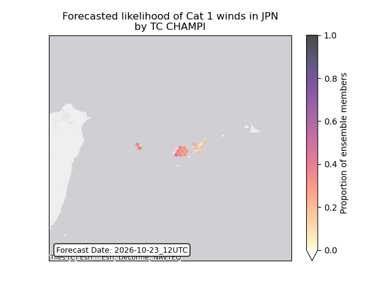

## CHAMPI Japan: people exposed

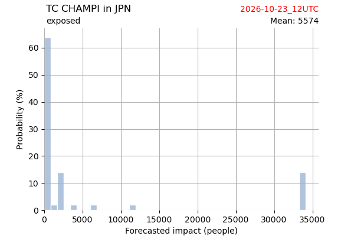

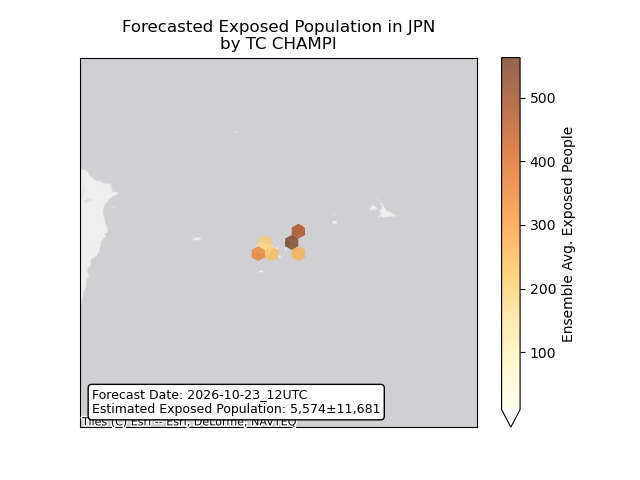

## CHAMPI Japan: people displaced

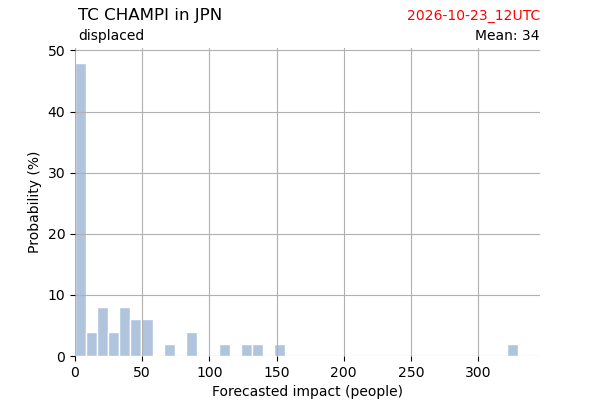

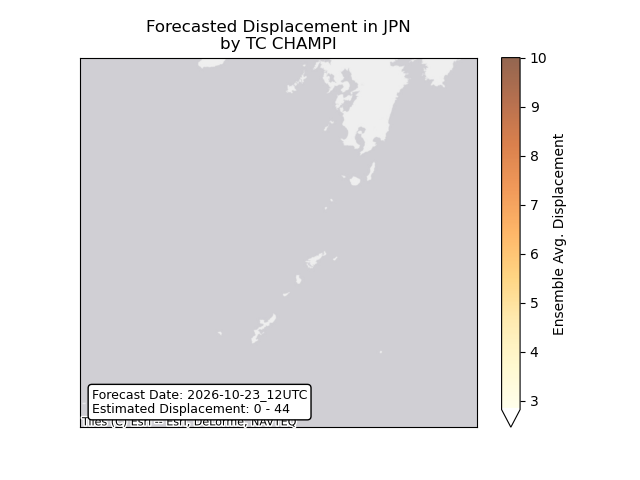

## CHAMPI Philippines: areas affected

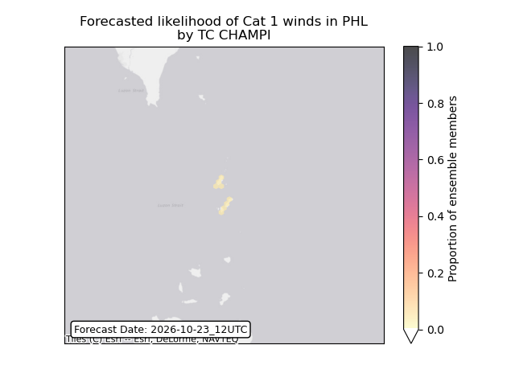

## CHAMPI Philippines: people exposed

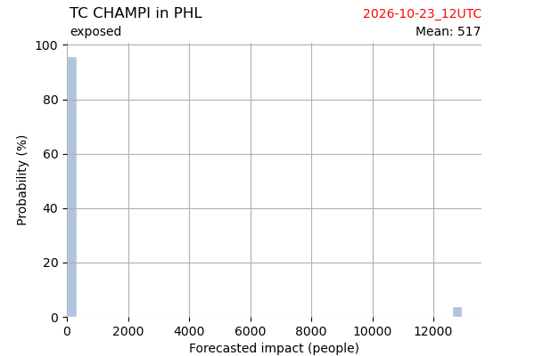

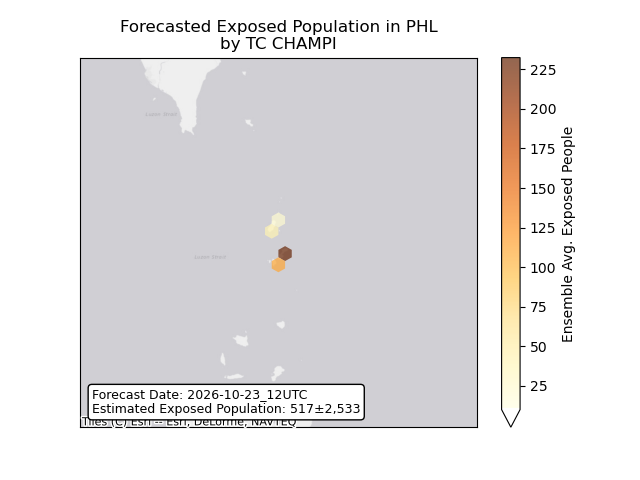

## CHAMPI Philippines: people displaced

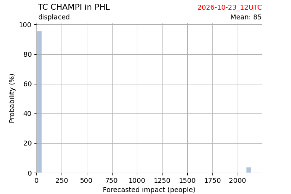

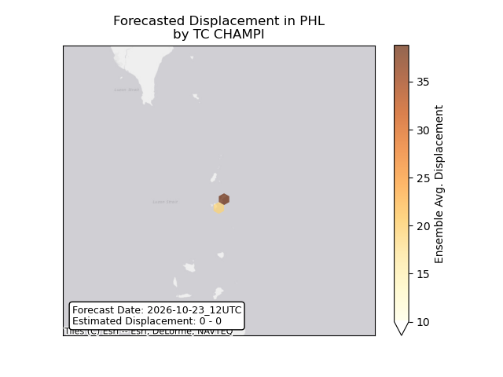

## CHAMPI Taiwan, Province of China: areas affected

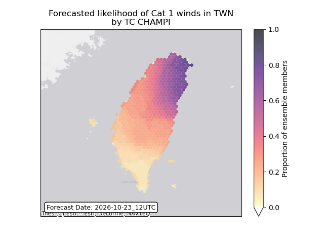

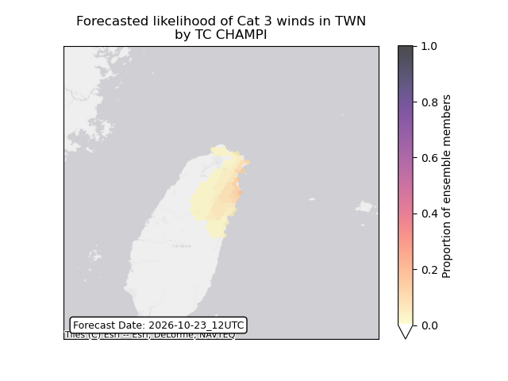

## CHAMPI Taiwan, Province of China: people exposed

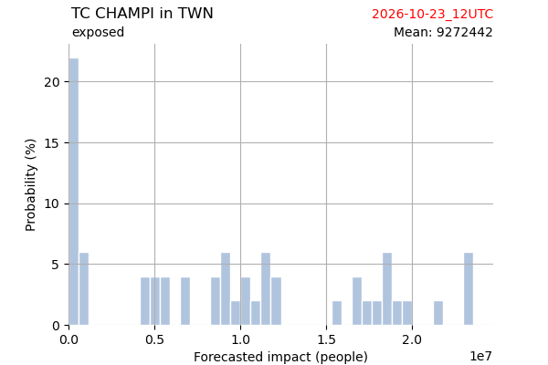

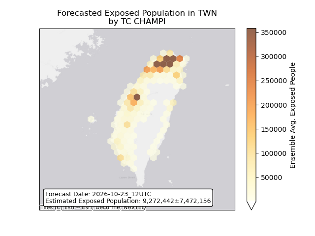

## CHAMPI Taiwan, Province of China: people displaced

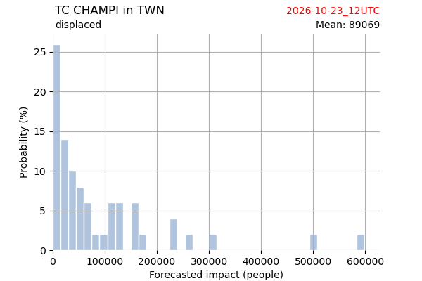

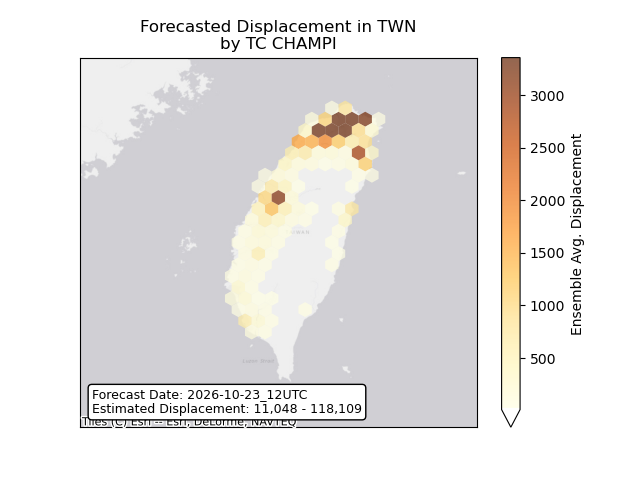

## VANCE Mexico: areas affected

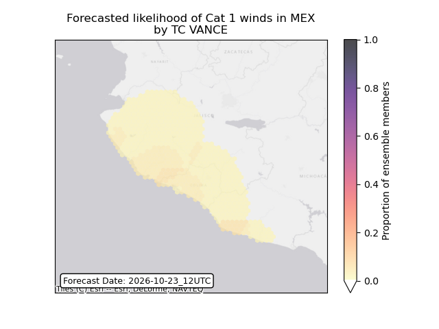

## VANCE Mexico: people exposed

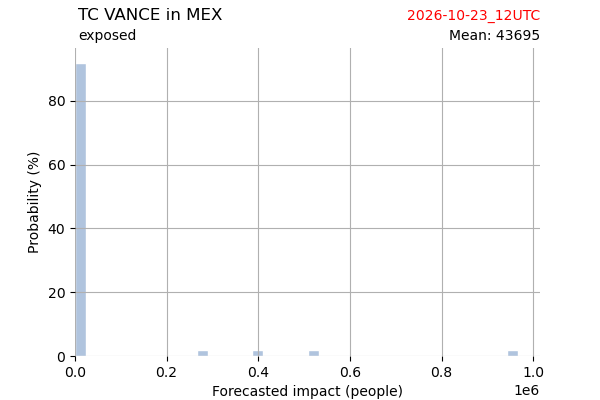

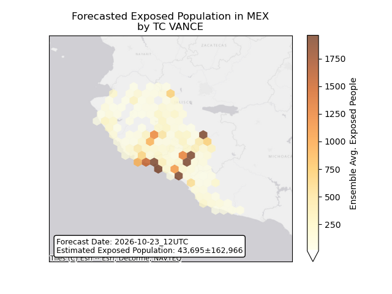

## VANCE Mexico: people displaced

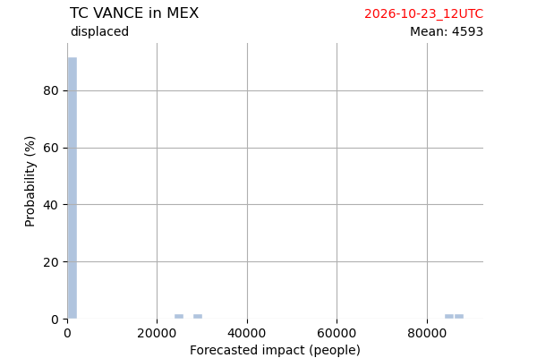

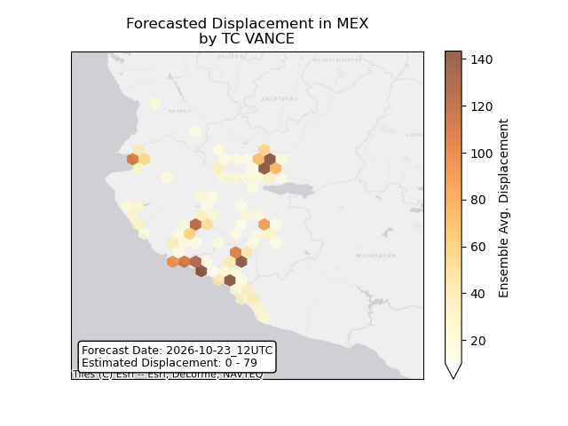

