# Displacement forecast

This is a WIP. All this is going to change, for now we're just dumping things here.

## Forecast for 2026-10-26 12:00 UTC

There are 4 active named storms.

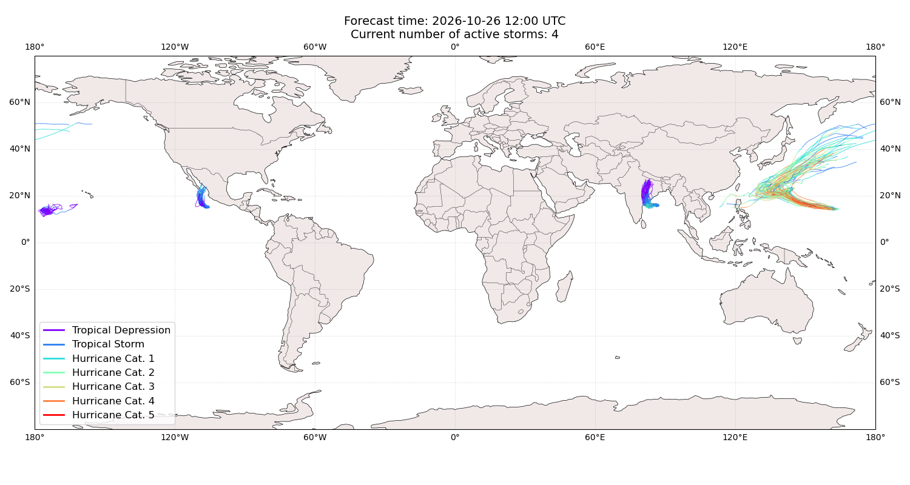

## IN-FA Japan: areas affected

## IN-FA Japan: people exposed

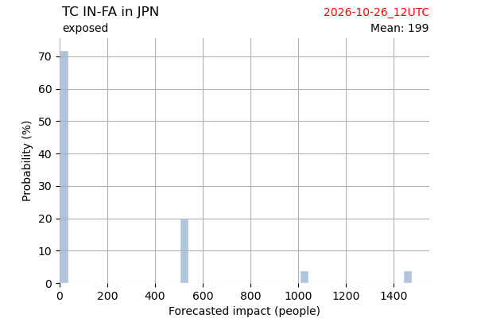

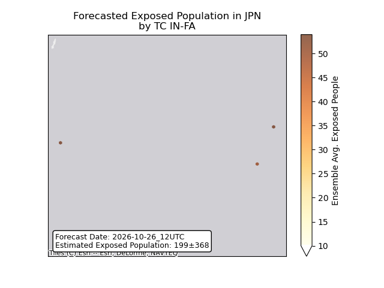

## IN-FA Japan: people displaced

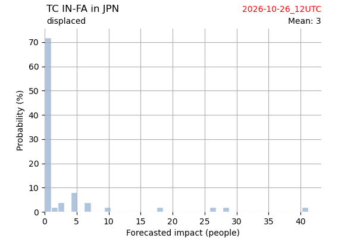

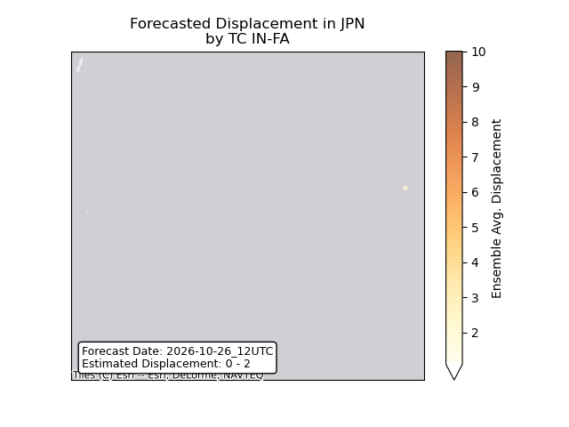

## IN-FA Northern Mariana Islands: areas affected

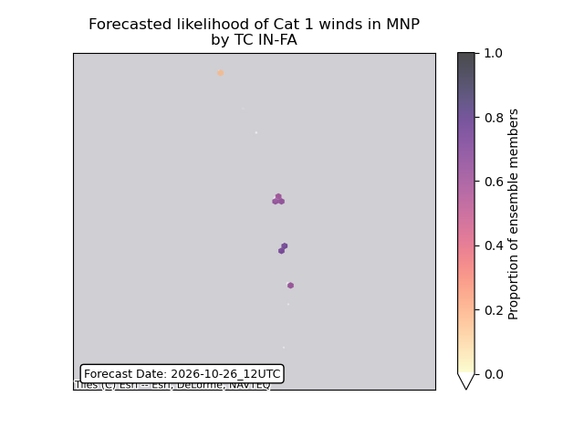

## IN-FA Philippines: no forecast people displaced

Storm IN-FA is not forecast to displace people in Philippines.

## IN-FA Philippines: areas affected

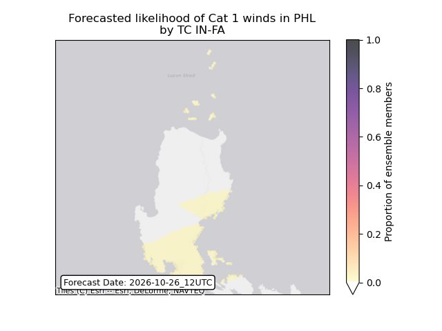

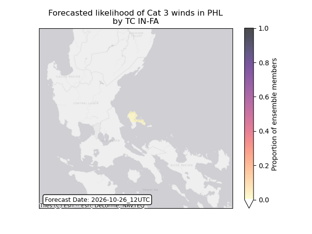

## IN-FA Philippines: people exposed

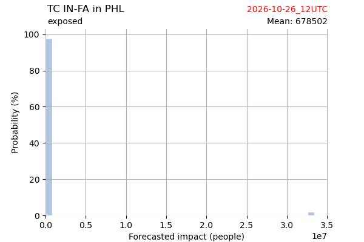

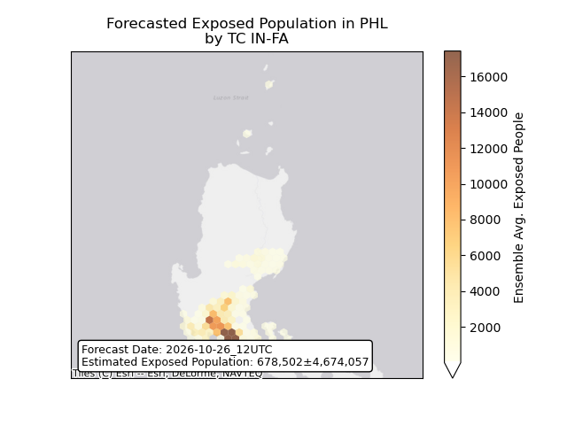

## IN-FA Philippines: people displaced

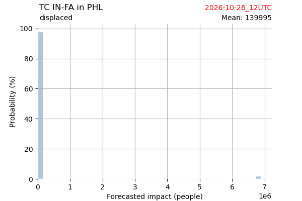

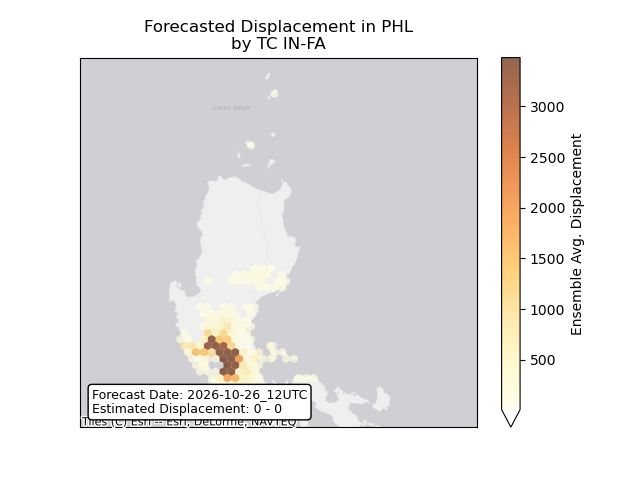

## IN-FA United States: areas affected

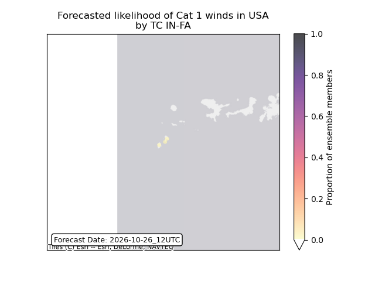

## OLANA All countries: no forecast people displaced

Storm OLANA is not forecast to displace people in All countries.

## OLANA All countries: No forecast people exposed

Storm OLANA is not forecast to affect people in All countries.

## OLANA All countries: no forecast people displaced

Storm OLANA is not forecast to displace people in All countries.

## VANCE All countries: No forecast people exposed

Storm VANCE is not forecast to affect people in All countries.

## VANCE All countries: no forecast people displaced

Storm VANCE is not forecast to displace people in All countries.

## ARNAB India: areas affected

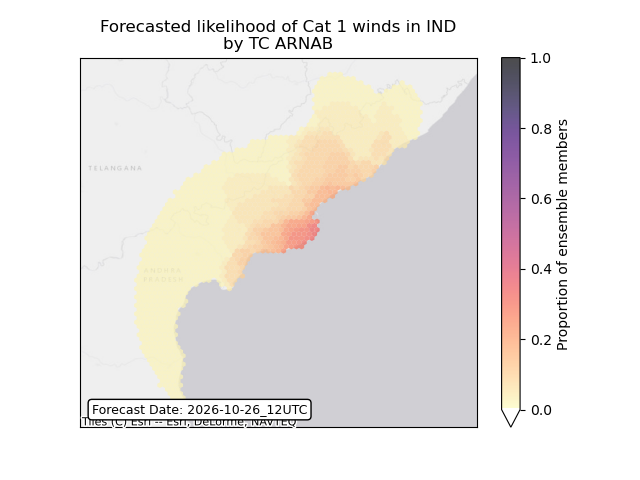

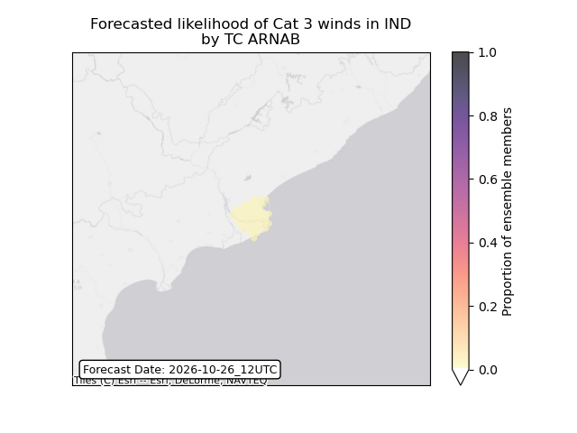

## ARNAB India: people exposed

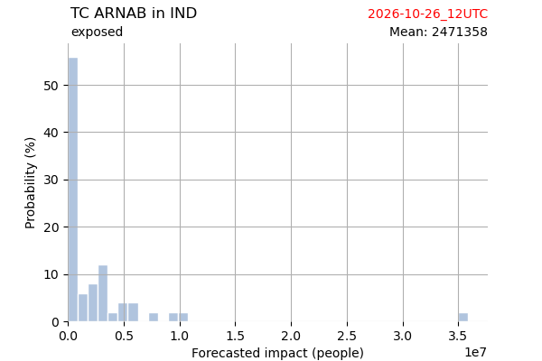

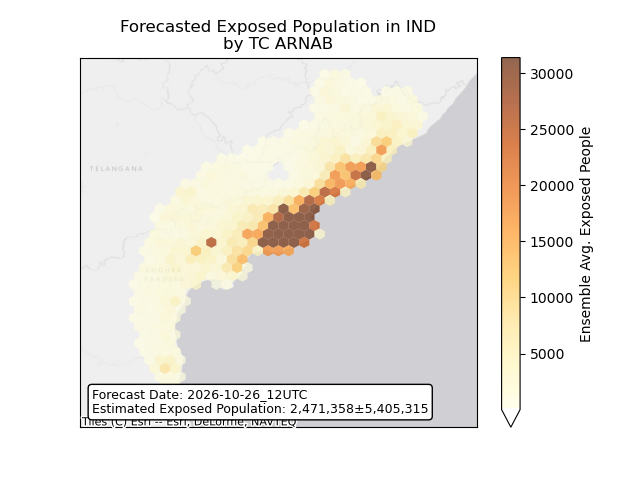

## ARNAB India: people displaced

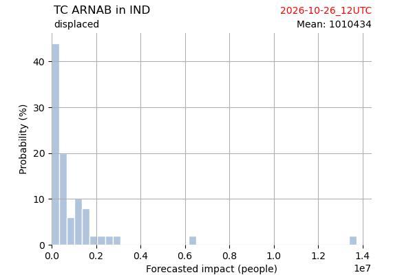

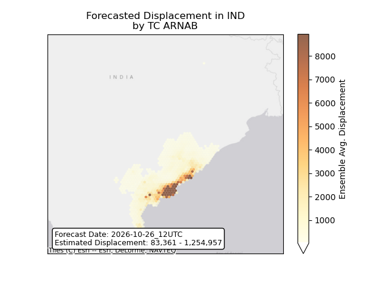

