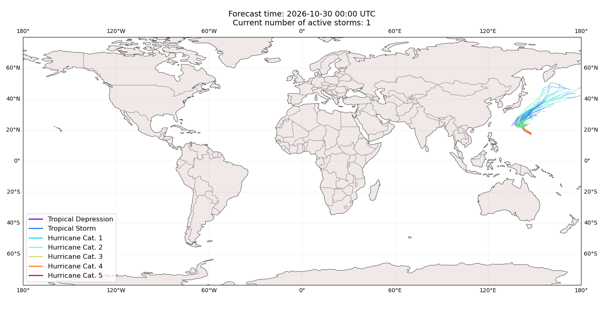
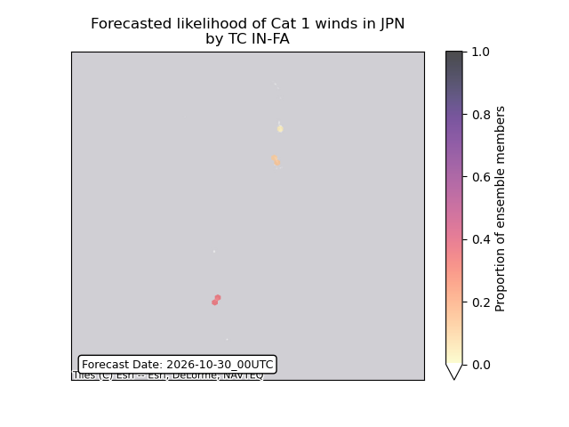
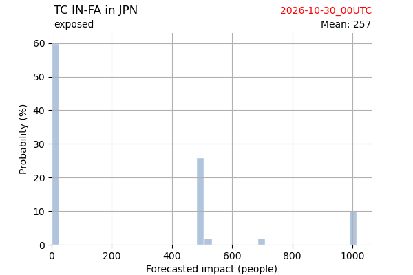
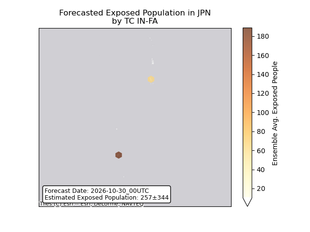
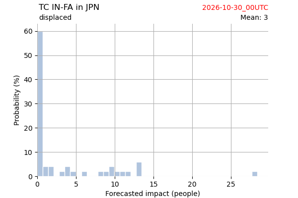
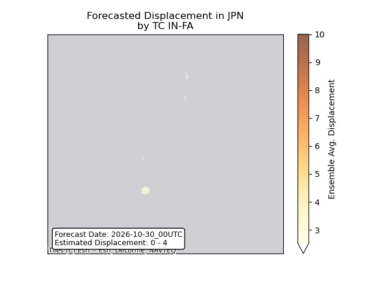
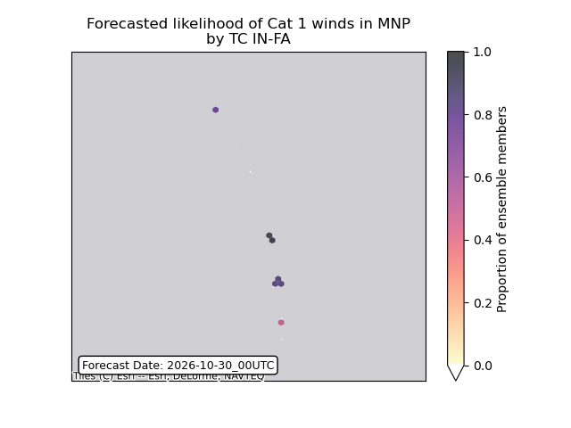

# Displacement forecast

This is a WIP. All this is going to change, for now we're just dumping things here.

## Forecast for 2026-10-30 00:00 UTC

There are 2 active named storms.

## VANCE All countries: No forecast people exposed

Storm VANCE is not forecast to affect people in All countries.

## VANCE All countries: no forecast people displaced

Storm VANCE is not forecast to displace people in All countries.

## IN-FA Japan: areas affected

## IN-FA Japan: people exposed

## IN-FA Japan: people displaced

## IN-FA Northern Mariana Islands: areas affected

## IN-FA Northern Mariana Islands: no forecast people displaced

Storm IN-FA is not forecast to displace people in Northern Mariana Islands.

