# Displacement forecast

This is a WIP. All this is going to change, for now we're just dumping things here.

## Forecast for 2026-10-31 00:00 UTC

There are 1 active named storms.

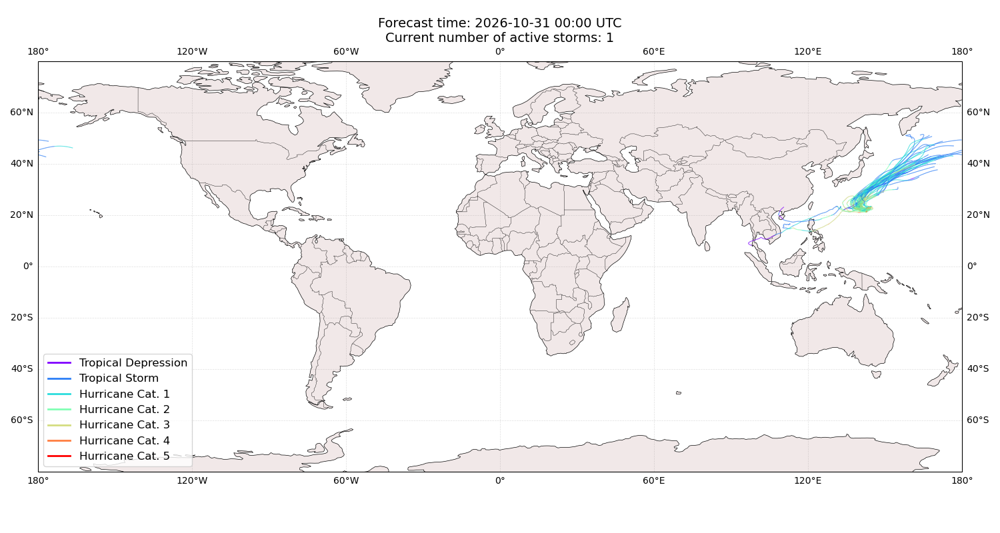

## IN-FA Japan: areas affected

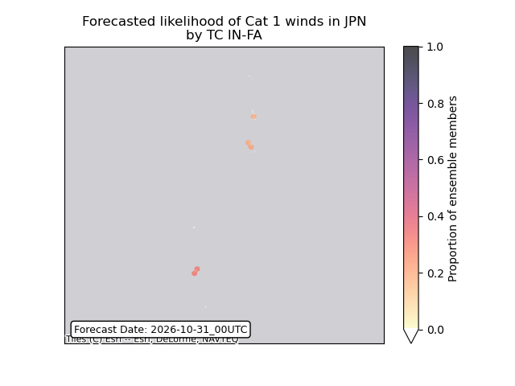

## IN-FA Japan: people exposed

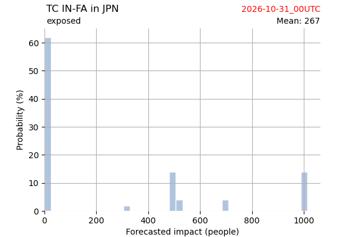

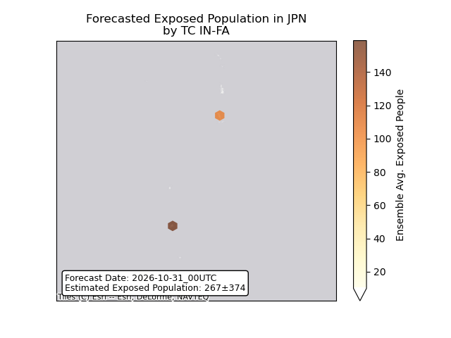

## IN-FA Japan: people displaced

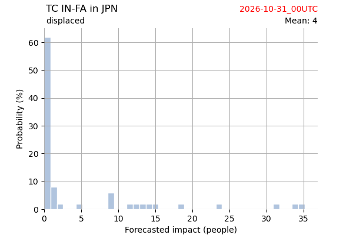

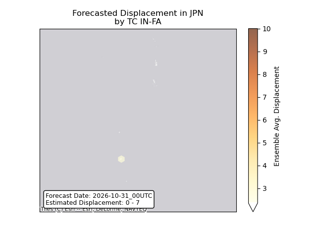

## IN-FA Philippines: areas affected

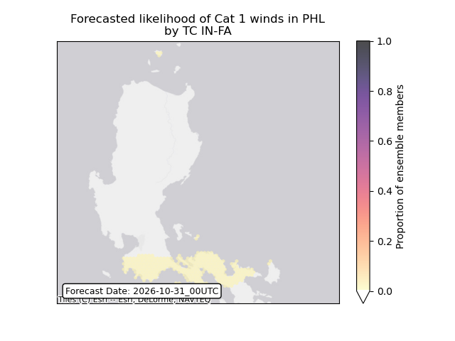

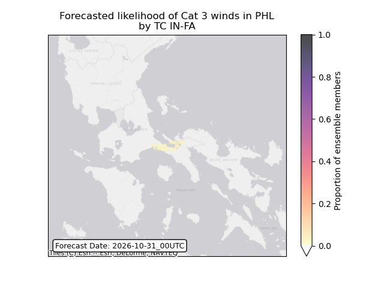

## IN-FA Philippines: people exposed

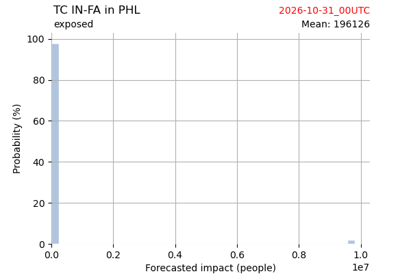

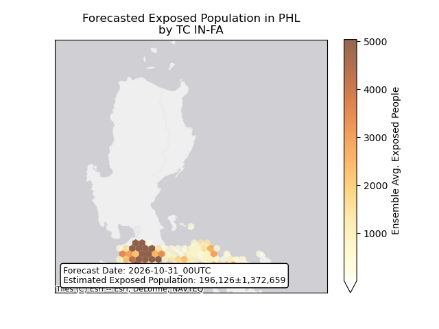

## IN-FA Philippines: people displaced

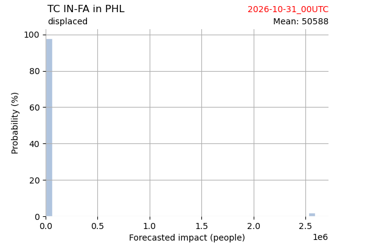

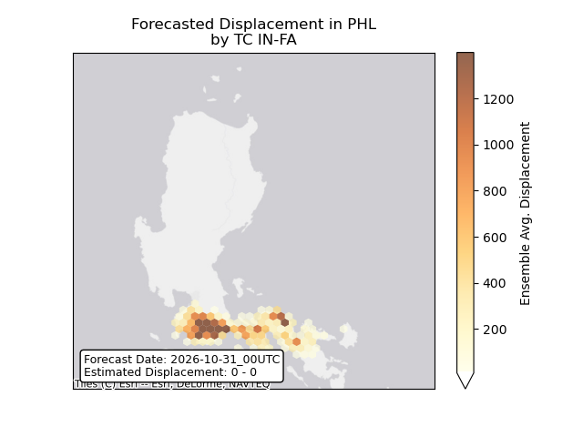

