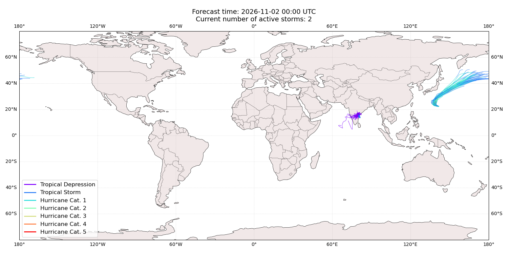
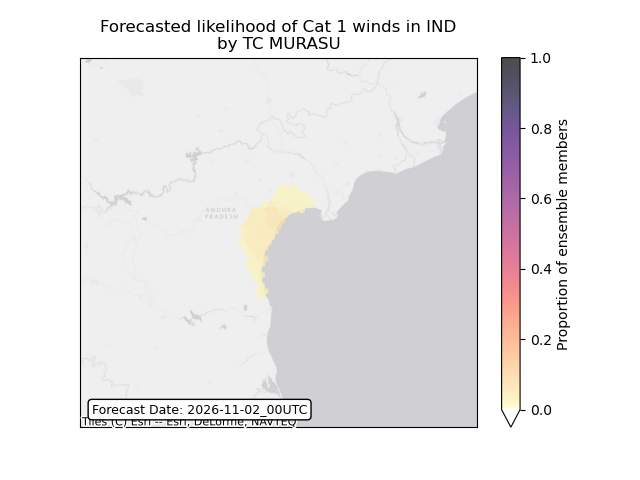
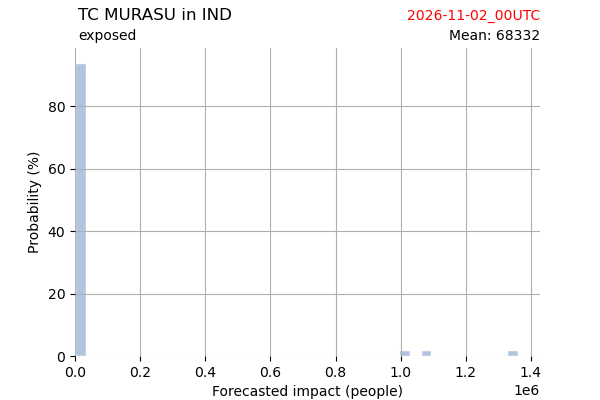
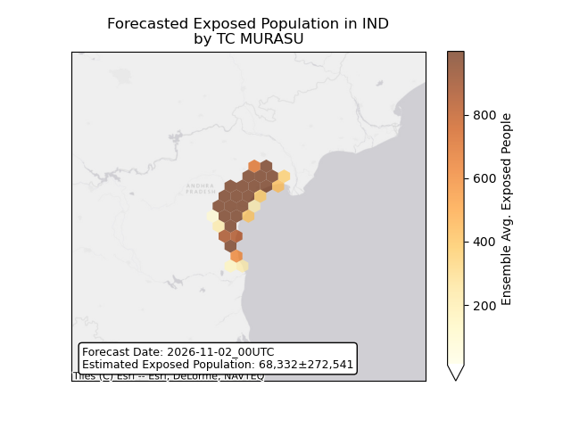
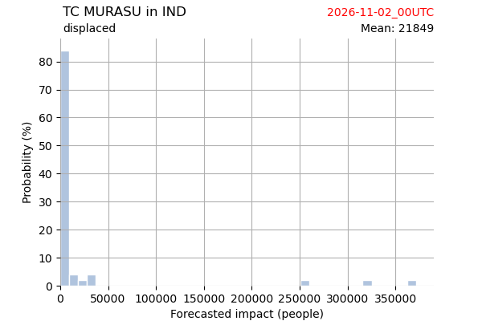
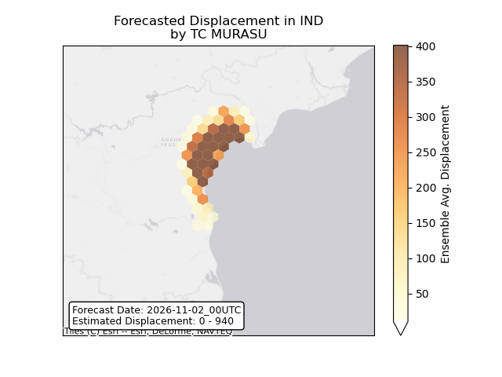

# Displacement forecast

This is a WIP. All this is going to change, for now we're just dumping things here.

## Forecast for 2026-11-02 00:00 UTC

There are 2 active named storms.

## MURASU India: areas affected

## MURASU India: people exposed

## MURASU India: people displaced

## IN-FA All countries: No forecast people exposed

Storm IN-FA is not forecast to affect people in All countries.

## IN-FA All countries: no forecast people displaced

Storm IN-FA is not forecast to displace people in All countries.

