# Displacement forecast

This is a WIP. All this is going to change, for now we're just dumping things here.

## Forecast for 2026-11-07 12:00 UTC

There are 2 active named storms.

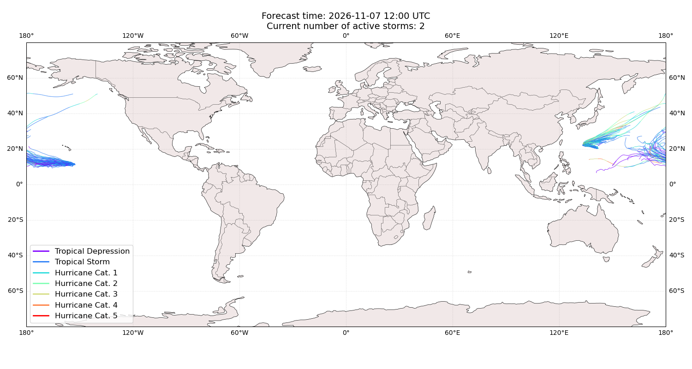

## CEMPAKA Japan: areas affected

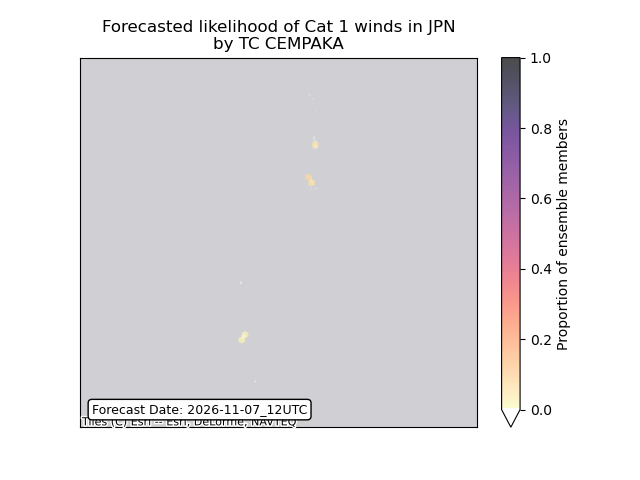

## CEMPAKA Japan: people exposed

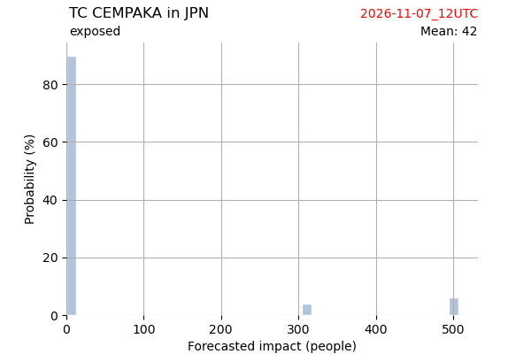

## CEMPAKA Japan: people displaced

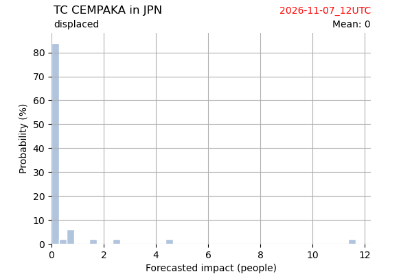

## CEMPAKA United States: areas affected

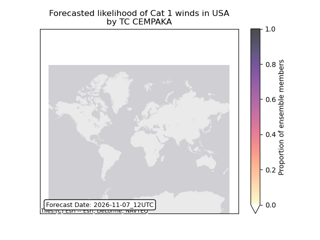

## CEMPAKA United States: people exposed

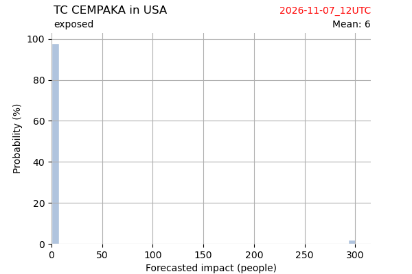

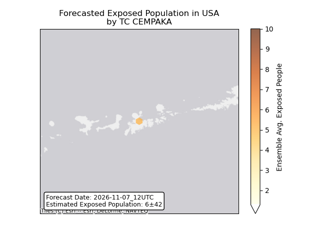

## CEMPAKA United States: people displaced

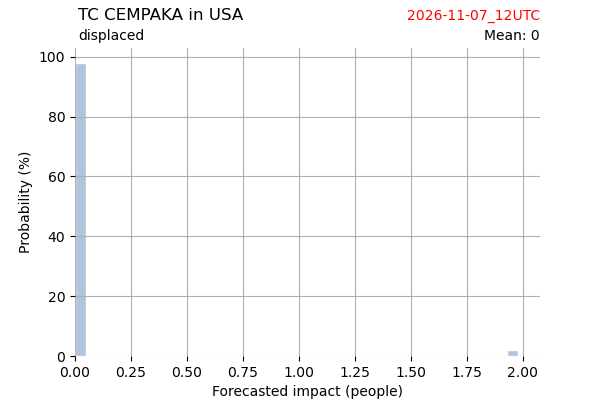

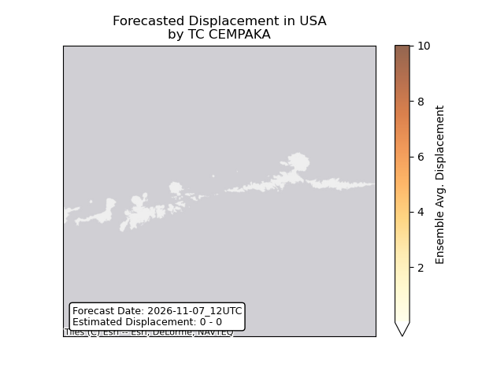

## PENA Guam: areas affected

## PENA Guam: people exposed

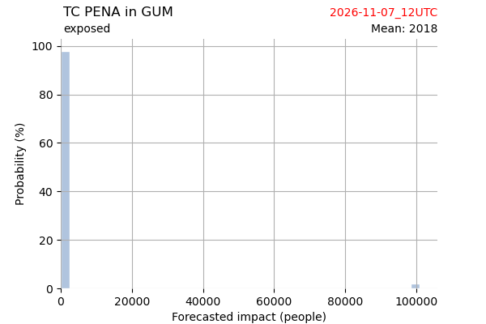

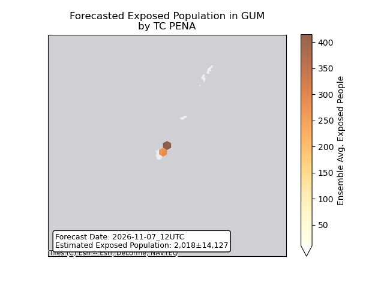

## PENA Guam: people displaced

## PENA Northern Mariana Islands: areas affected

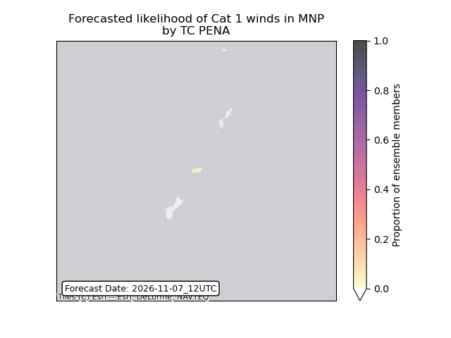

## PENA Northern Mariana Islands: people exposed

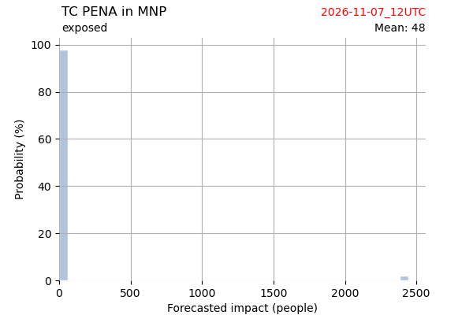

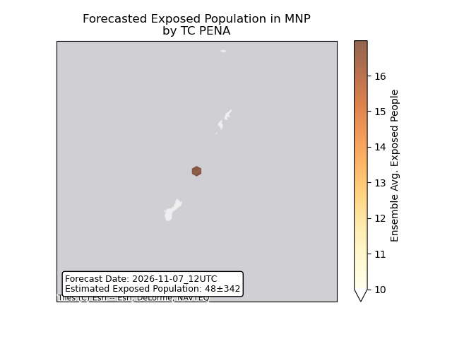

## PENA Northern Mariana Islands: people displaced

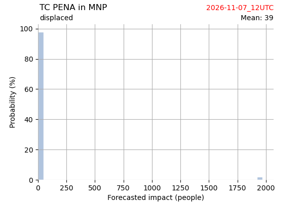

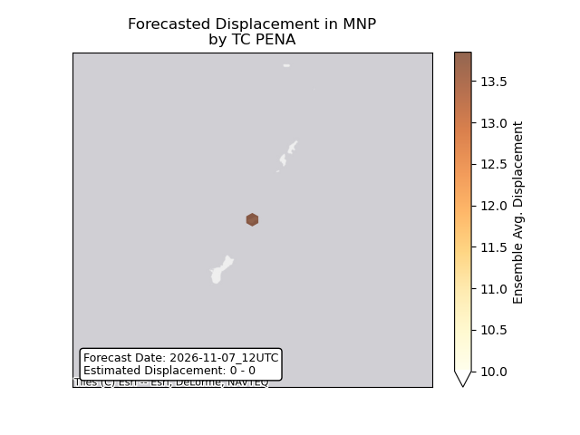

