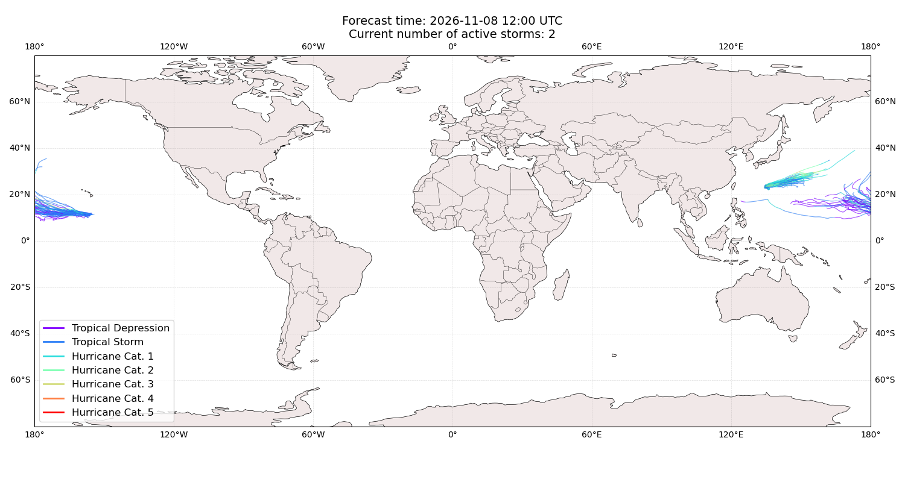
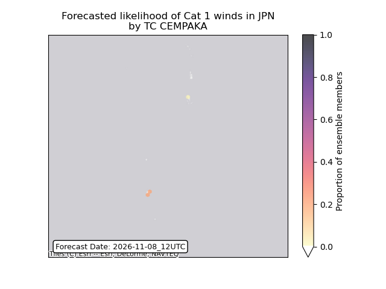
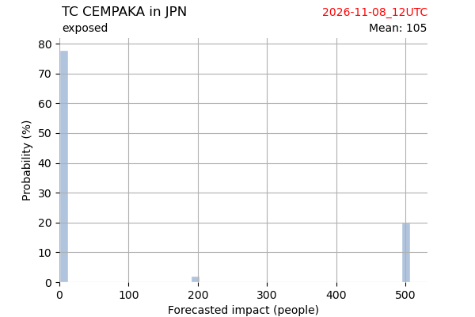
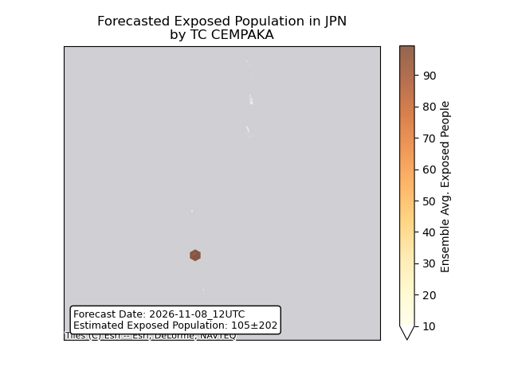
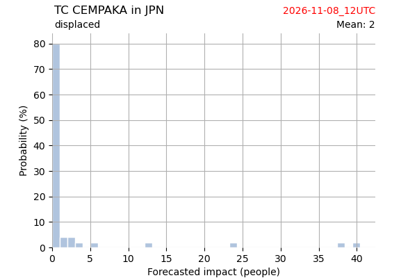
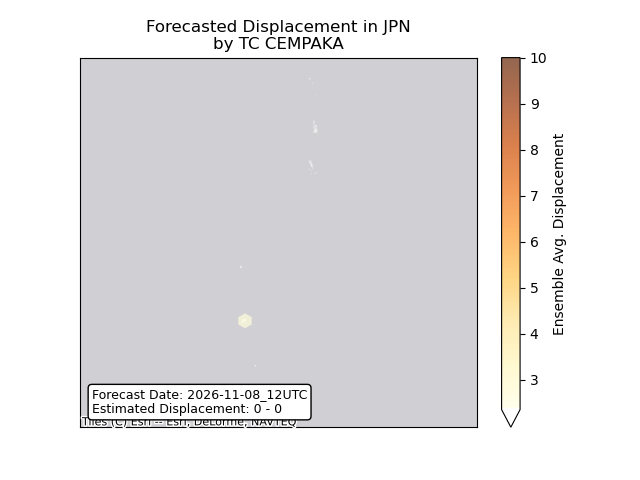

# Displacement forecast

This is a WIP. All this is going to change, for now we're just dumping things here.

## Forecast for 2026-11-08 12:00 UTC

There are 2 active named storms.

## PENA All countries: No forecast people exposed

Storm PENA is not forecast to affect people in All countries.

## PENA All countries: no forecast people displaced

Storm PENA is not forecast to displace people in All countries.

## CEMPAKA Japan: areas affected

## CEMPAKA Japan: people exposed

## CEMPAKA Japan: people displaced

