# Displacement forecast

This is a WIP. All this is going to change, for now we're just dumping things here.

## Forecast for 2026-11-12 00:00 UTC

There are 2 active named storms.

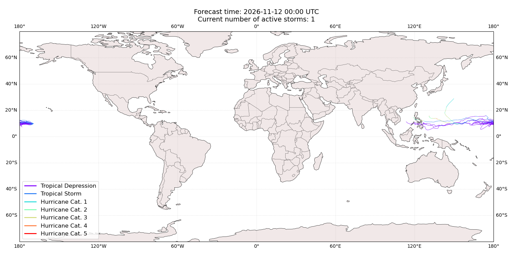

## CEMPAKA All countries: No forecast people exposed

Storm CEMPAKA is not forecast to affect people in All countries.

## CEMPAKA All countries: no forecast people displaced

Storm CEMPAKA is not forecast to displace people in All countries.

## PENA Northern Mariana Islands: areas affected

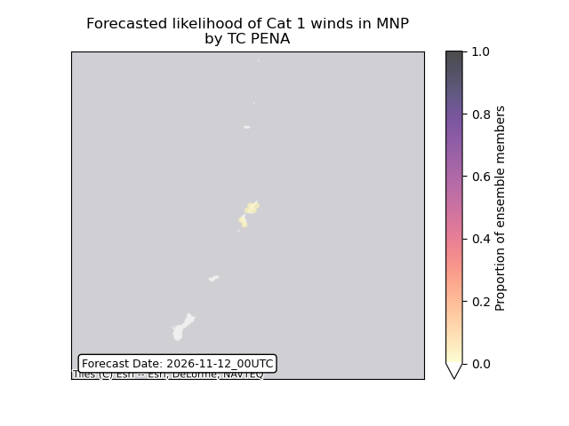

## PENA Northern Mariana Islands: people exposed

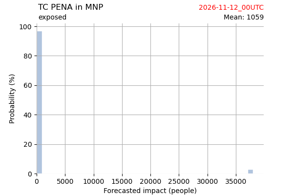

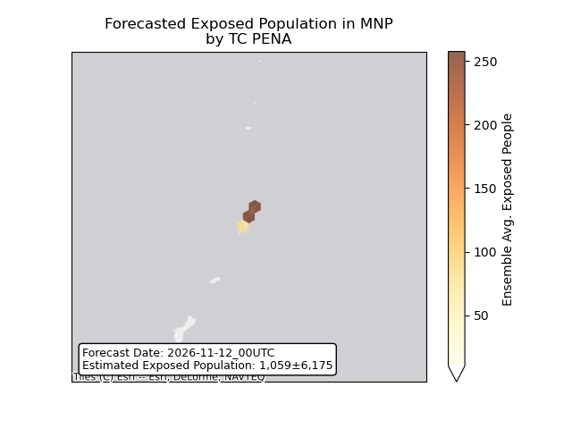

## PENA Northern Mariana Islands: people displaced

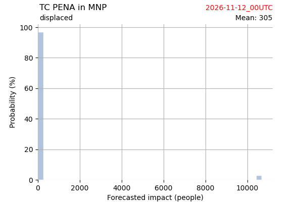

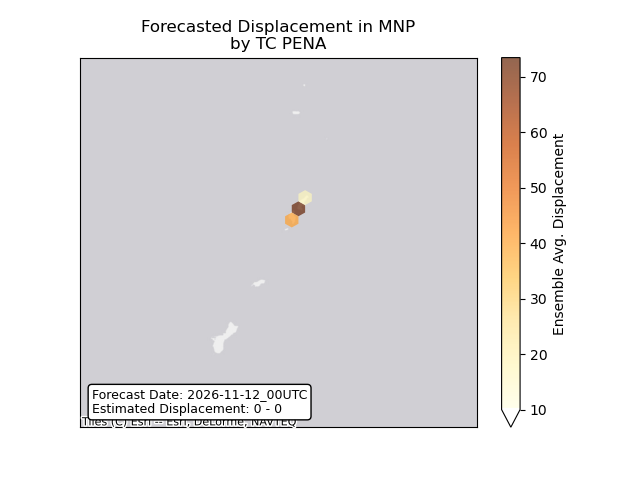

## PENA Philippines: areas affected

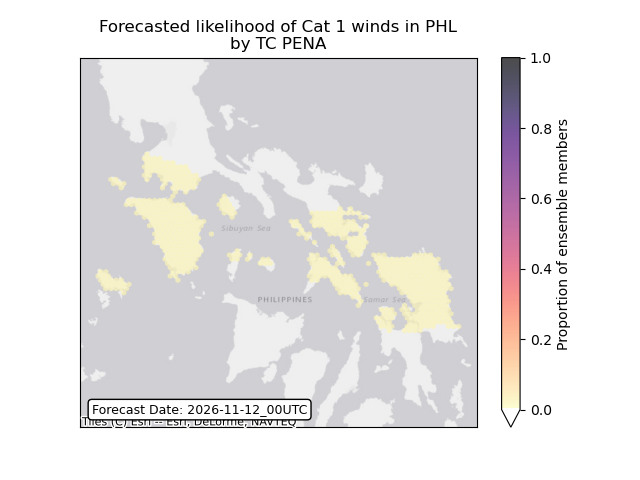

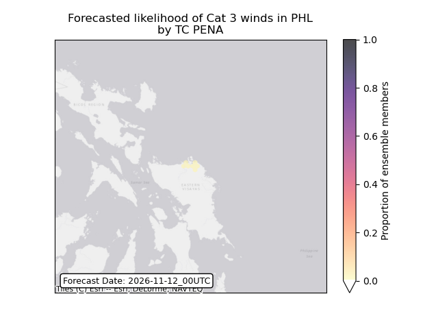

## PENA Philippines: people exposed

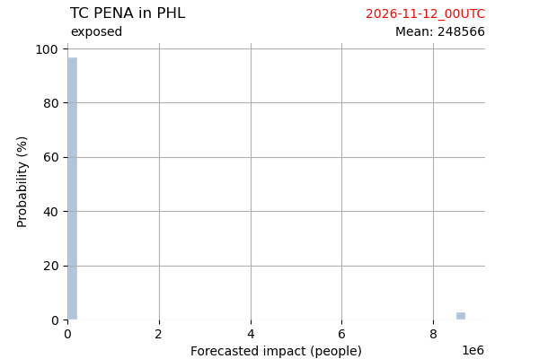

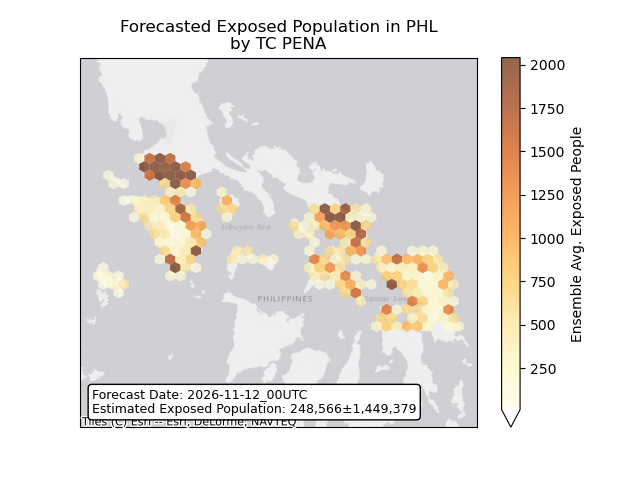

## PENA Philippines: people displaced

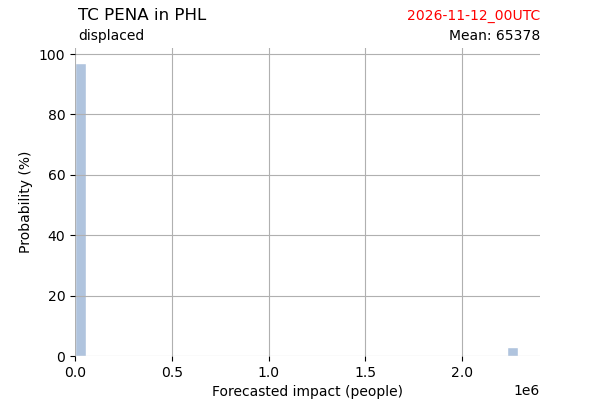

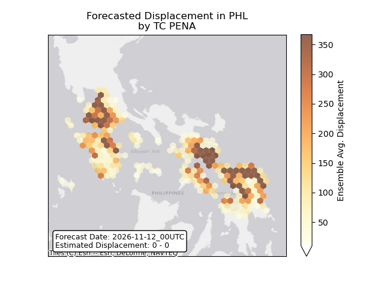

