# Displacement forecast

This is a WIP. All this is going to change, for now we're just dumping things here.

## Forecast for 2026-11-15 12:00 UTC

There are 1 active named storms.

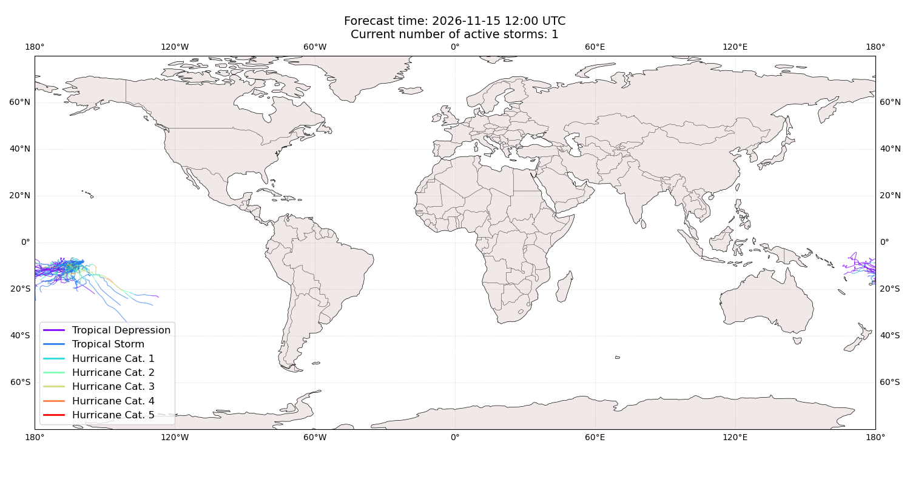

## XAVIER American Samoa: areas affected

## XAVIER American Samoa: people exposed

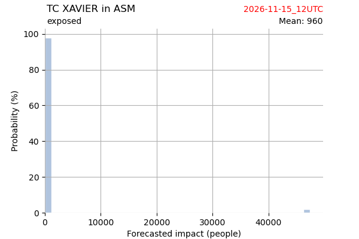

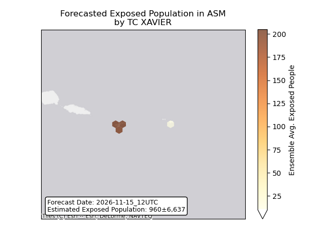

## XAVIER American Samoa: people displaced

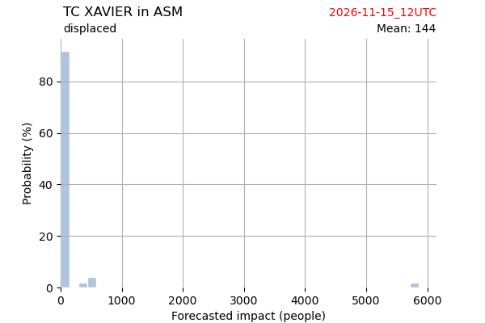

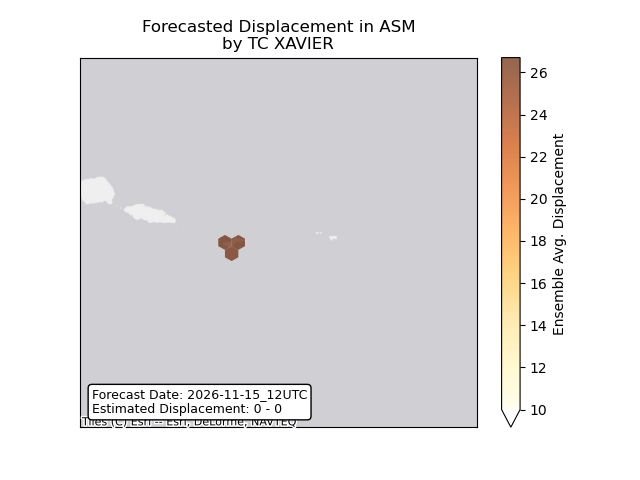

## XAVIER Cook Islands: areas affected

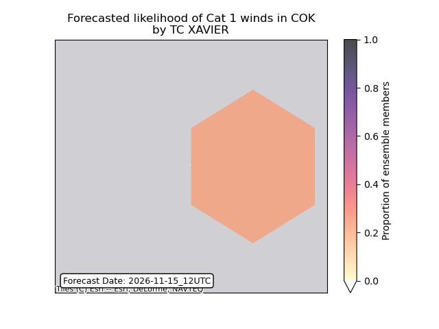

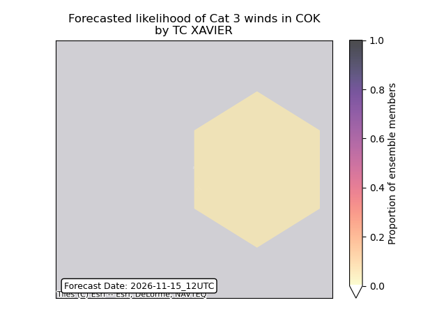

## XAVIER French Polynesia: no forecast people displaced

Storm XAVIER is not forecast to displace people in French Polynesia.

## XAVIER French Polynesia: areas affected

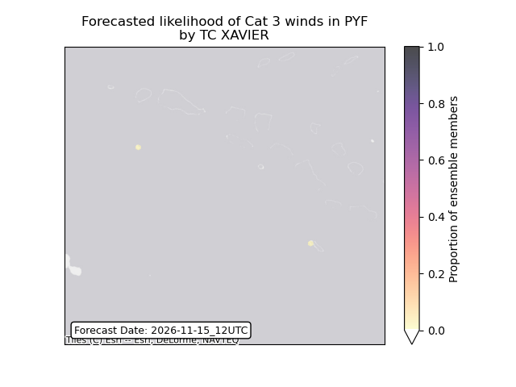

## XAVIER French Polynesia: people exposed

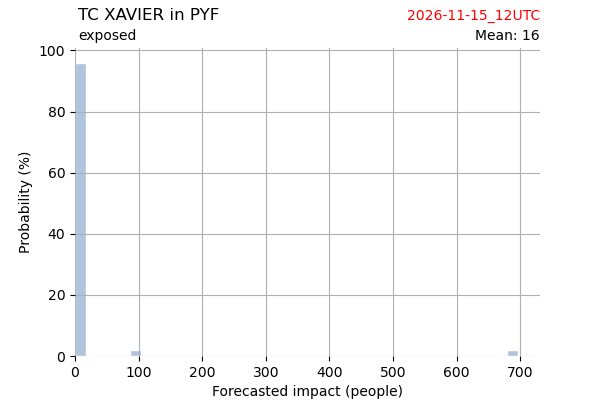

## XAVIER French Polynesia: people displaced

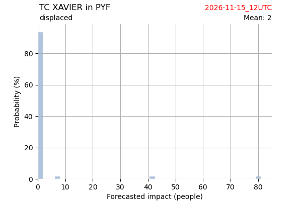

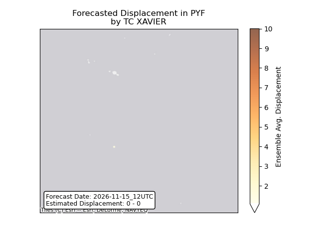

## XAVIER Wallis and Futuna: areas affected

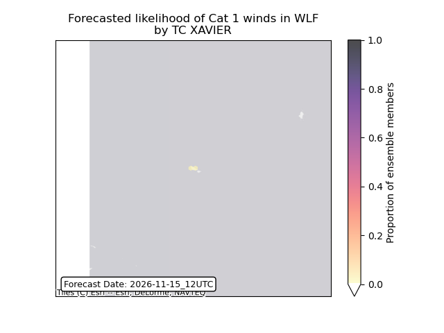

## XAVIER Wallis and Futuna: people exposed

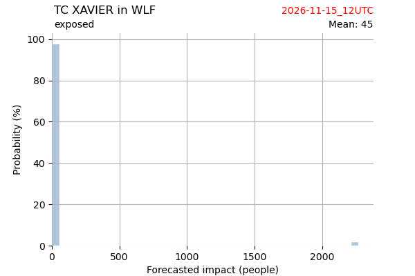

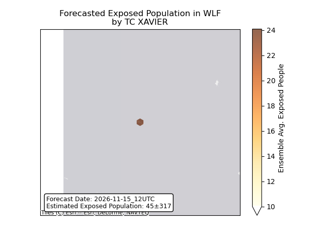

## XAVIER Wallis and Futuna: people displaced

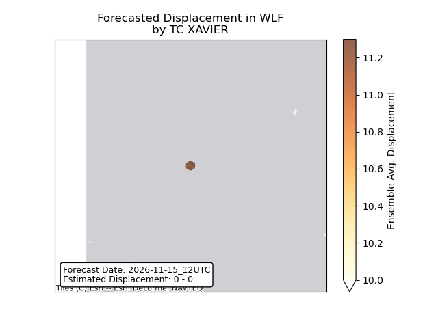

