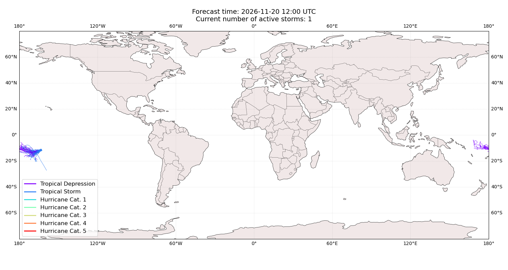
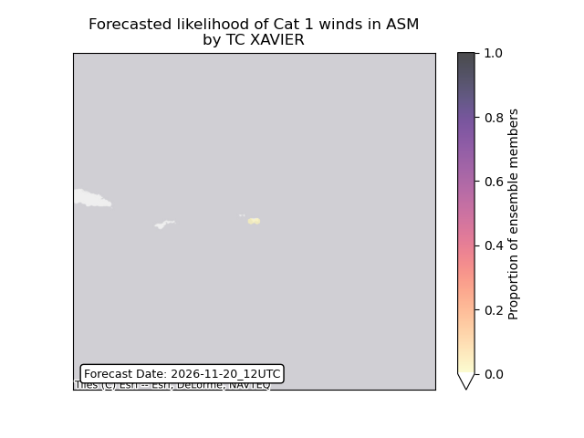
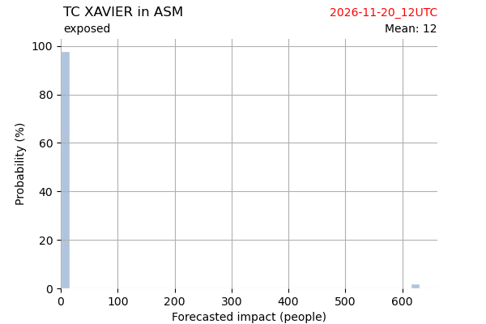
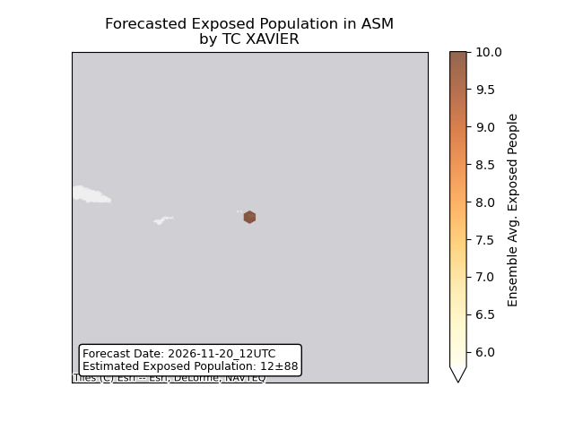
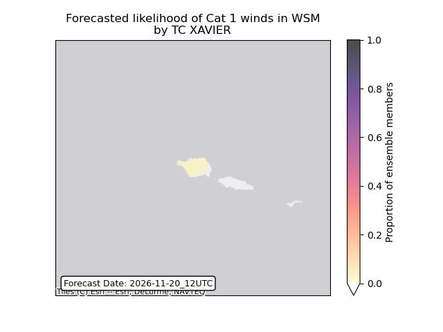
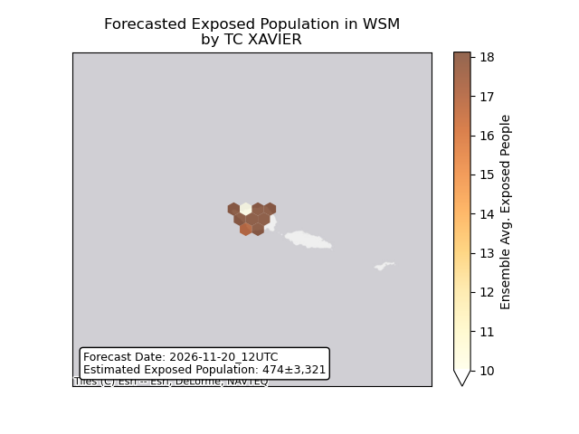
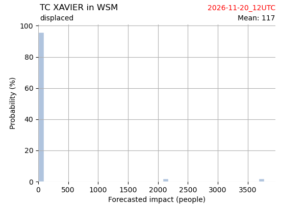
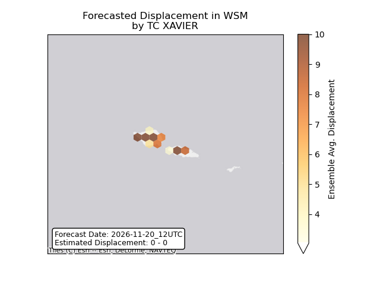

# Displacement forecast

This is a WIP. All this is going to change, for now we're just dumping things here.

## Forecast for 2026-11-20 12:00 UTC

There are 1 active named storms.

## XAVIER American Samoa: areas affected

## XAVIER American Samoa: people exposed

## XAVIER American Samoa: people displaced

## XAVIER Samoa: areas affected

## XAVIER Samoa: people exposed

## XAVIER Samoa: people displaced

